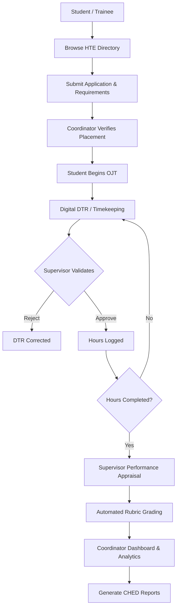

# MenteeLog - OJT & Internship Management System

**A modern, secure, and structured web-based On-the-Job Training tracking system.**

---

## Project Overview
MenteeLog is a centralized, department-level web platform designed to streamline On-the-Job Training (OJT) tracking, eliminate paper-based Daily Time Records (DTR), simplify Host Training Establishment (HTE) accreditation, and provide a highly controlled digital workflow for students, industry supervisors, and academic coordinators.

## Brand Guidelines & Identity
MenteeLog represents a modern, clean, and highly professional aesthetic.
* **Colors:** Deep Maroon (Primary branding), Soft Sand/Beige (Backgrounds and premium cards), Clean White (Negative space), and Dark Slate (Typography).
* **Typography:** Modern sans-serif fonts optimized for maximum readability across dense data tables and mobile dashboards.
* **UI Philosophy:** Buttery-smooth CSS transitions, hardware-accelerated GPU animations, and zero-jank interaction design.

## Project Objectives
* **Simplify** student OJT placements with a verified HTE directory.
* **Eliminate** manual, easily-forged paper DTRs.
* **Provide** GPS-verified clock-in and clock-out mechanisms.
* **Track** intern break times with granular precision.
* **Enforce** strict Supervisor-only review and approval of daily hours.
* **Automate** the student grading process via a built-in 5-point evaluation rubric.
* **Deliver** God-view analytics for global cohort compliance.
* **Generate** instant CHED-compliant export reports.
* **Maintain** strict audit logs, role-based access, and incident reporting structures.

---

## System Roles & Permissions
MenteeLog consists of three strictly separated system roles.

| Role | Main Responsibilities |
| --- | --- |
| **Student / Trainee** | Registration, placement application, document uploads, read-only DTR monitoring, and incident filing. |
| **Supervisor / Industry Partner** | Slot management, candidate review, Timekeeper Authority (approving DTRs), and 5-point performance appraisals. |
| **Coordinator / Faculty Admin**| System administration, HTE accreditation, bulk assignment, compliance monitoring, analytics, and CHED reports. |

---

## System Overview & Workflow Diagrams

The overall MenteeLog process follows this strict lifecycle:



### Database Schema (ERD)


### Platform Site Map


### System Process Flow


---

## DETAILED STUDENT FLOW - INSTRUCTIONS

1. **Student Login**
   The student logs into the system using their secure ID and password.
2. **Access OJT Directory**
   The student navigates to the placement directory to view accredited HTEs.
3. **Submit Application**
   The student selects an active slot and submits their profile for review.
4. **Supervisor & Coordinator Review**
   The system waits for the HTE Supervisor to Accept, and the Coordinator to Endorse.
5. **Placement Secured**
   Once endorsed, the student is officially locked to that HTE.
6. **Begin OJT Shift**
   The student reports to the HTE for duty.
7. **Timekeeping (Read-Only)**
   The supervisor clocks the student in via the Timekeeper Terminal.
8. **Live DTR Sync**
   The student views their Read-Only DTR dashboard updating in real-time.
9. **Hours Completed**
   The student completes their required OJT hours.
10. **Final Appraisal Review**
   The student views their final 5-point grading rubric score submitted by the supervisor.
11. **END**
   The OJT process is completed.

---

## DETAILED SUPERVISOR (HTE) FLOW - INSTRUCTIONS

1. **Supervisor Login**
   The industry partner logs into their restricted HTE account.
2. **Post Job Slots**
   The supervisor creates a job posting locked strictly to their company profile.
3. **Review Applicants**
   The supervisor views incoming student applications.
4. **Accept / Reject Candidate**
   The supervisor decides whether to hire the student for the OJT slot.
5. **Manage Daily Attendance**
   When the student arrives, the supervisor opens the Timekeeper Terminal.
6. **Live GPS Validation**
   The supervisor clocks the student in. (The system validates the GPS location).
7. **Manage Breaks**
   The supervisor logs any break times taken by the student.
8. **Clock Out & Commit**
   The supervisor clocks the student out. The net hours are permanently logged.
9. **Conduct Performance Appraisal**
   Once all hours are finished, the supervisor accesses the Appraisal module.
10. **Submit 5-Point Rubric**
   The supervisor grades the student across 5 technical and behavioral metrics.
11. **END**
   The student's final grade is transmitted to the Coordinator.

---

## Portal Modules Breakdown

### Student Portal
* **Dashboard:** Overview of active hours, total progress, and placement status.
* **OJT Placement:** Verified directory of available HTE positions.
* **My Applications:** Status tracker for submitted placement requests.
* **Performance Appraisal:** Read-only view of supervisor evaluations.
* **DTR Hub:** Read-only digital time record synced instantly with the supervisor's terminal.
* **Documents:** Secure portal to upload clearances, waivers, and ID requirements.
* **Incident Reports:** Direct line to file safety claims or disputes.

### Supervisor Portal
* **Dashboard:** Roster of active interns and pending tasks.
* **Candidate Review & Application Review:** Pipeline for accepting or rejecting student applicants.
* **Attendance & DTR (Timekeeper Terminal):** The absolute-authority terminal to log student hours, breaks, and remarks.
* **Performance Appraisal:** Built-in 5-point grading rubric to instantly compute student performance.
* **Slot Management:** Creation of job postings tied securely to the supervisor's read-only company profile.
* **Incident Reports:** Disciplinary logging system.

### Coordinator Portal
* **Dashboard:** High-level metrics of cohort placement and compliance.
* **Job Management & Application Review:** Oversight of all active postings and placements.
* **HTE Accreditation:** Management of partnered companies.
* **Student Placement:** Bulk assignment capabilities for unplaced students.
* **DTR Compliance:** God-view audit of all logged hours across all companies.
* **Report Generation:** Analytics charts and 1-click CHED compliance CSV exports.
* **User Management & Incident Reports:** Administrative oversight of accounts and severe disputes.

---

## Security & Authentication Logic

MenteeLog uses layered security mechanisms to enforce data integrity:

* **Authentication:** Protected API endpoints, JWT-based security (planned integration), and Role-Based routing.
* **Absolute-Authority Timekeeping:** Unlike legacy systems where students punch their own time, MenteeLog grants *only* the Supervisor the authority to commit hours, ensuring zero forgery.
* **Role-Based Access Control (RBAC):** Users are strictly routed to their designated portals. Supervisors cannot access global cohort data, and Students cannot alter their own DTR hours.
* **Field-Level Locks:** Sensitive data, such as a Supervisor's company affiliation, is locked (`readonly`) at the UI level to prevent misrepresentation during slot creation.

---

## Technology Stack

**Frontend:**
* React.js (Component-based UI)
* Vite (High-speed build tool)
* Vanilla JavaScript (ES6+ Logic)
* CSS3 (High-performance transitions & GPU acceleration)
* Leaflet.js (GPS & Geolocation mapping)

**Backend & Database:**
* Node.js & Express
* Supabase (Auth & Database)
* PostgreSQL (Relational Data structure)
* RESTful APIs

**Design & Prototyping:**
* Figma

---

## Development Roadmap

* **Foundation:** [====================] 100%
* **Authentication & RBAC Routing:** [====================] 100%
* **DTR & Timekeeping Authority:** [====================] 100%
* **Supervisor Appraisals:** [==================  ] 90%
* **Coordinator Analytics & Reports:** [============        ] 60%
* **Testing & Integration:** [======              ] 30%
* **Overall Development:** [================    ] ~80%

---

## Testing Strategy

**Student Testing:**
* Valid login, session creation, and profile access.
* Placement application submission and duplicate prevention.
* Correct denial of access to editing DTR fields (Read-Only verification).
* Real-time reaction of the DTR Hub when a supervisor clocks them in.
* File upload validation for requirements.

**Supervisor Testing:**
* RBAC restrictions on the Company name during Slot Management.
* Acceptance and rejection of candidates with proper status updates.
* Accurate calculation of Net Hours (subtracting break times).
* Successful submission of the 5-point rubric evaluation and lock-out post-submission.
* GPS validation prompts on the Timekeeper Terminal.

**Coordinator Testing:**
* Accurate generation of bulk CSV reports across the entire cohort.
* Correct display of cohort analytics charts and progress bars.
* Successful bulk assignment of students to an HTE.
* Administrative oversight of Incident Reports.

---

## Team MenteeLog
MenteeLog is developed collaboratively by Team MenteeLog.

| Name | Responsibility |
| --- | --- |
| **Jeff A. Gentapanan** | Project Manager |
| **Kyle Renzo C. Alis** | Software Generalist |
| **Cristina Bernadette Porras** | UI/UX Designer |
| **John Paul B. Wendam** | Frontend Developer |
| **Jhodie Alyssa Ladran** | Backend Developer |
| **Sean Nichole S. Guipo** | Backend Developer |
| **Rolly G. Abella** | Researcher |

---

## Live Demonstration

The production deployment is hosted live on Vercel:
* **Production URL:** [https://menteelog-system.vercel.app](https://menteelog-system.vercel.app)

To run the frontend prototype locally:

```bash
cd MenteeLog
npm install
npm run dev
```
