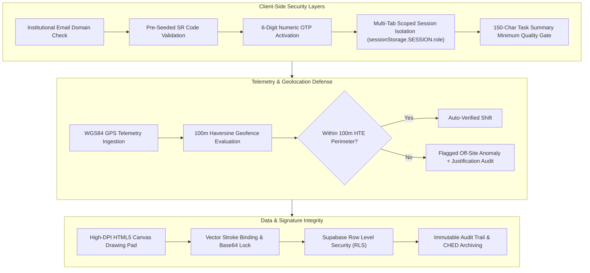

# MenteeLog — OJT & Internship Management System

**A modern, secure, and centralized web-based On-the-Job Training tracking platform.**

[](#-academic-scope--institutional-policy)
[](#-academic-scope--institutional-policy)
[](#-institutional-compliance--ched-cmo-104-s-2017-alignment)
[-4285F4.svg?style=for-the-badge)](#-antigravity-ai-engineering--architecture-collaboration)

---

## 📌 Project Overview

**MenteeLog** is a specialized, enterprise-grade On-the-Job Training (OJT) and internship management system engineered to modernize, automate, and govern university internship programs. It completely replaces fragile, easily forged paper Daily Time Records (DTR) and uncoordinated logbooks with an automated, tamper-resistant digital ecosystem.

MenteeLog unifies the entire internship lifecycle across three interconnected portals:
1. **OJT Student Interns** — Autonomous placement discovery, automated 100m GPS geofenced attendance tracking, millisecond shift timers with break tracking, saved task drafts, printable DTR exports, and digital appraisal transparency.
2. **Host Training Establishment (HTE) Supervisors** — Streamlined applicant screening pipelines, automated on-site attendance crediting, off-site anomaly justification audits with location maps, and 7-criteria performance evaluations authenticated via drawn digital canvas signatures.
3. **Faculty OJT Coordinators & Academic Administrators** — Corporate HTE accreditations, bulk student cohort placements, continuous compliance queues, dispute and incident mediation, and single-click CHED completion reporting.

Developed specifically for university academic departments (with initial rollout tailored for Batangas State University), MenteeLog enforces strict academic integrity, automated geofence verifications, and standardized institutional compliance.

---

## 🎓 Academic Scope & Institutional Policy

### 1. BSIT (Bachelor of Science in Information Technology) Course ONLY
MenteeLog is **purpose-built and strictly scoped exclusively for Bachelor of Science in Information Technology (BSIT)** curricula:
* **Curricular Hour Target:** Optimized for BSIT required internship hours (standard 300 to 500 hours depending on the academic track).
* **Technical Industry Tracks:** Listings, skill tags, and evaluation instruments are calibrated for software engineering, web and mobile development, network administration, ICT infrastructure, database management, technical support, and cybersecurity internships.
* **Non-BSIT Syllabi Excluded:** MenteeLog does not accommodate clinical hospital rotations (Nursing), maritime sea-time logs, or hotel/restaurant kitchen duty rotations, as each non-IT discipline possesses vastly divergent accreditation rubrics and regulatory board mandates.

### 2. Strict Institutional Student Email Requirement
> [!IMPORTANT]
> **MenteeLog strictly requires educational institutions to provide official institutional student email accounts (e.g., `@g.batstate-u.edu.ph`, `@university.edu.ph`).**

* **Schools Without Institutional Email Systems Are NOT Supported:** Educational institutions that do not issue institutional email accounts to their students cannot be onboarded to MenteeLog.
* **Identity Verification & Anti-Impersonation:** Account activation requires matching an institutional email domain with a pre-seeded student identification number (SR Code). Public, free, or disposable email addresses (such as `@gmail.com`, `@yahoo.com`, or `@outlook.com` for student accounts) are barred from self-registration to prevent impersonation, unauthorized roster infiltration, and academic fraud.
* **Automated Identity Binding:** Pre-seeding student rosters via CSV binds each student's SR Code directly to their official institutional email address, ensuring only verified students can receive activation OTPs and access the platform.

---

## ⚠️ System Boundaries, Constraints & Limitations

To ensure transparency and operational reliability, MenteeLog operates under clearly defined technical and institutional boundaries:

| Dimension | Scope & Policy | Operational Constraint & Mitigation |
| :--- | :--- | :--- |
| **Academic Program** | **BSIT Only** | Does not support non-IT disciplines (nursing, maritime, HRM, education). |
| **Institutional Email** | **Mandatory Institutional Domain** | Universities without institutional email domains cannot onboard; ensures verified academic identity. |
| **GPS Geofence Perimeter** | **Strict 100-Meter Radial Boundary** | Calibrated to the physical building footprint of accredited HTE offices. Clock-ins outside 100m are flagged as off-site anomalies. |
| **Client Geolocation Hardware** | **HTML5 Geolocation API Dependent** | Requires client devices with GPS hardware/location services enabled. Indoor multipath or browser permission blocks are resolved via the Attendance Justification Modal. |
| **Network Connectivity** | **Online Real-Time Transmission** | Telemetry, shift timestamps, and task summaries require an active internet connection at clock-in and clock-out moments; offline synchronization is not supported. |
| **Fieldwork & Remote Tasks** | **Exception Justification Workflow** | Interns assigned to client sites, outdoor networking, or remote duties must submit an Attendance Justification with map pins and proof for supervisor approval. |

---

## 🎨 Brand Guidelines & Identity

* **Primary Palette:** Deep Burgundy (`#58111A`), Rose Accent (`#D85A63`), Warm Sand/Cream (`#FAF4E8` / `#EFDFBB`), and Emerald Success (`#059669`).
* **Typography:** Clean, high-legibility sans-serif ([Inter](https://fonts.google.com/specimen/Inter), `system-ui`) and monospace technical accents (`ui-monospace`, [JetBrains Mono](https://fonts.google.com/specimen/JetBrains+Mono)) for coordinate, telemetry, and time tracking.
* **UI Philosophy:** Clean institutional cards, frosted acrylic glassmorphism, hardware-accelerated GPU transitions, interactive [React Bits](https://www.reactbits.dev) & [Anime.js](https://animejs.com)-inspired physics, and responsive data tables.
* **Map Design:** Custom [Leaflet.js](https://leafletjs.com) map layer with branded vector SVG pins (teardrop corporate office pin for workplaces and live pulsing GPS radar beacons for interns).

---

## 🎯 Main Objectives & Key Pillars

* **Verified HTE Placements:** Eliminate unaccredited student placements through a vetted directory of partner companies with active Memorandums of Agreement (MOA).
* **Automated 100m GPS Geofence Verification:** Replace manual, easily-forged paper DTRs with automated geofence verification. Shifts clocked within the accredited 100-meter workplace perimeter are automatically verified upon clock-out, freeing company supervisors from tedious daily timekeeper tasks.
* **Interactive Fullscreen Mapping:** Equip students, supervisors, and coordinators with a high-definition Leaflet map and dedicated `⛶ Wide / Fullscreen` viewer (`100dvh` mobile-safe viewport) to inspect clock-in coordinates, geofence boundaries, and live telemetry.
* **Exception-Based Anomaly Handling:** Shifts recorded outside the accredited 100m perimeter are flagged automatically, prompting the intern to submit an official justification with an embedded clock-in geolocation record map for supervisor review.
* **Granular Break & Shift Tracking:** Accurately compute net rendered hours by deducting lunch and personal breaks with precision resumption and zero lost time.
* **7-Criteria Performance Appraisal with Drawn Signatures:** Streamline intern evaluations with a 5-point rubric (+ N/A option) and an executive HTML5 high-DPI canvas drawing pad for authentic digital signatures.
* **Faculty Governance & God-View Analytics:** Equip coordinators with real-time cohort tracking, incident mediation hubs, and single-click CHED CMO 104 s. 2017 compliant completion and compliance reports.
* **Tamper-Resistant Security:** Enforce strict Role-Based Access Control (RBAC), multi-tab session isolation, OTP account activation, and comprehensive audit logs.

---

## 🤖 Antigravity AI Engineering & Architecture Collaboration

MenteeLog was engineered in close collaboration with **[Antigravity AI](https://deepmind.google)**, Google DeepMind's Advanced Agentic Coding assistant. The agentic AI architecture played an instrumental role across critical engineering modules:

1. **Geodesic Haversine Geofencing Engine:**
   * Formulated and implemented the spherical trigonometry [Haversine algorithm](https://en.wikipedia.org/wiki/Haversine_formula) in vanilla JavaScript to calculate real-time Euclidean distance between student GPS telemetry and HTE company coordinates with sub-meter precision.
   * Engineered the automated 100m boundary evaluation logic that automatically categorizes shifts into verified on-site records versus flagged off-site anomalies.
2. **High-DPI Canvas Draw Signature Station:**
   * Designed the responsive [HTML5 Canvas 2D](https://developer.mozilla.org/en-US/docs/Web/API/CanvasRenderingContext2D) drawing pad with dynamic `devicePixelRatio` scaling, eliminating blurriness on retina displays and mobile touch screens.
   * Implemented smooth Bézier curve interpolation for pen/mouse strokes, clear canvas handlers, and base64 vector extraction directly embedded into appraisal records.
3. **Multi-Tab Scoped Session Isolation:**
   * Diagnosed and eliminated cross-tab session bleed and accidental role overwrites by creating an isolated session management architecture (`sessionStorage.SESSION.<role>`).
   * Ensured browser refreshes retain the exact portal subview, active shift timer state, and draft reflections without session termination.
4. **Custom Vector SVG Mapping & Coordinate Calibration:**
   * Replaced generic raster icons with bespoke, hardware-rendered SVG teardrop corporate pins and pulsing emerald radar beacons (`mlgPulse`).
   * Calibrated pixel anchor points to `[22, 53]` to ensure mathematical needle-tip precision on Leaflet map tiles.
   * Implemented the fullscreen modal overlay with dynamic `100dvh` mobile-safe height, Leaflet tile re-rendering, and `ESC` key accessibility.
5. **Quality-Gated Build & Zero-Regression Verification:**
   * Managed automated test cycles, [Vite 8](https://vite.dev) module bundling, memory allocation optimizations, and syntax integrity validations via [Oxlint](https://oxc.rs/docs/guide/usage/linter.html) to ensure zero compilation errors.

---

## 🛠️ Comprehensive Technology Stack, APIs & Official Resource Links

### 1. Core Languages & Web Standards
* **JavaScript ([ECMAScript 2023 / ES6+](https://tc39.es/ecma262/)):** Modular vanilla ES module architecture (`export`, `import`) delivering near-zero runtime overhead and maximum execution speed. ([MDN JavaScript Reference](https://developer.mozilla.org/en-US/docs/Web/JavaScript))
* **HTML5 ([WHATWG HTML Living Standard](https://html.spec.whatwg.org/)):** Semantic markup, native `<dialog>` modals, custom SVG graphic nodes, and [HTML5 Canvas API](https://developer.mozilla.org/en-US/docs/Web/API/Canvas_API) for digital signature capture.
* **CSS3 ([W3C CSS Specifications](https://www.w3.org/Style/CSS/)):** Custom design token system, CSS custom properties (variables), Flexbox/CSS Grid layouts, dynamic viewport units (`100dvh`), glassmorphism filters, and GPU-accelerated `@keyframes` animations.
* **SQL ([PostgreSQL 15+ Dialect](https://www.postgresql.org/docs/)):** Relational schema definitions, foreign keys, check constraints, and [Supabase Row Level Security (RLS)](https://supabase.com/docs/guides/database/postgres/row-level-security) policies.

### 2. Frontend Framework, Bundler & Developer Tooling
* **[Vite 8.x (`^8.3.0`)](https://vite.dev):** Next-generation frontend build tool providing instant Hot Module Replacement (HMR) and optimized production bundling. ([NPM: `vite`](https://www.npmjs.com/package/vite) | [GitHub: `vitejs/vite`](https://github.com/vitejs/vite))
* **[React 19 (`^19.2.8`)](https://react.dev) & [React DOM (`^19.2.8`)](https://www.npmjs.com/package/react-dom):** Utilized with [`@vitejs/plugin-react`](https://www.npmjs.com/package/@vitejs/plugin-react) for reactive ecosystem integration. ([NPM: `react`](https://www.npmjs.com/package/react))
* **[Oxlint (`^1.81.0`)](https://oxc.rs/docs/guide/usage/linter.html):** Ultra-fast Rust-based JavaScript/TypeScript linter from the Oxidation Compiler (Oxc) project ensuring clean syntax and strict code quality. ([NPM: `oxlint`](https://www.npmjs.com/package/oxlint) | [GitHub: `oxc-project/oxc`](https://github.com/oxc-project/oxc))
* **[Node.js (v20+ LTS)](https://nodejs.org):** JavaScript runtime environment supporting build scripts, package management ([npm](https://www.npmjs.com)), and maintenance automation.

### 3. Mapping, GIS, Geolocation & Export Libraries
* **[Leaflet.js (`v1.9.4`)](https://leafletjs.com):** Open-source, mobile-friendly interactive mapping library powering the 100m geofence visualization, custom SVG pin rendering, and coordinate projection.
  * **Official Website & Docs:** [https://leafletjs.com/reference.html](https://leafletjs.com/reference.html)
  * **NPM Package:** [https://www.npmjs.com/package/leaflet](https://www.npmjs.com/package/leaflet)
  * **UNPKG CDN Stylesheet:** [`https://unpkg.com/leaflet@1.9.4/dist/leaflet.css`](https://unpkg.com/leaflet@1.9.4/dist/leaflet.css)
  * **UNPKG CDN Script:** [`https://unpkg.com/leaflet@1.9.4/dist/leaflet.js`](https://unpkg.com/leaflet@1.9.4/dist/leaflet.js)
* **[OpenStreetMap (OSM) Raster Tile Server API](https://www.openstreetmap.org):** Standardized open-source cartographic tile provider delivering street-level geographic topology.
  * **Documentation:** [https://wiki.openstreetmap.org/wiki/Raster_tile_providers](https://wiki.openstreetmap.org/wiki/Raster_tile_providers)
  * **Tile Endpoint Pattern:** `https://{s}.tile.openstreetmap.org/{z}/{x}/{y}.png`
* **[W3C HTML5 Geolocation API](https://developer.mozilla.org/en-US/docs/Web/API/Geolocation_API):** Browser hardware API (`navigator.geolocation.getCurrentPosition` & `watchPosition`) interfacing directly with client GPS sensors for WGS84 latitude, longitude, and accuracy radius ingestion. ([W3C Specification](https://w3c.github.io/geolocation/))
* **[html2pdf.js (`v0.10.1`)](https://ekoopmans.github.io/html2pdf.js/):** Client-side HTML-to-PDF generator (combining `html2canvas` and `jsPDF`) used to export printable Daily Time Records (DTR) and CHED compliance sheets.
  * **GitHub Repository:** [https://github.com/eKoopmans/html2pdf.js](https://github.com/eKoopmans/html2pdf.js)
  * **UNPKG CDN Bundle:** [`https://unpkg.com/html2pdf.js@0.10.1/dist/html2pdf.bundle.min.js`](https://unpkg.com/html2pdf.js@0.10.1/dist/html2pdf.bundle.min.js)

### 4. Backend-as-a-Service (BaaS), Cloud Database & Transactional Email APIs
* **[Supabase (`@supabase/supabase-js` `^2.117.2`)](https://supabase.com):**
  * **Official Platform & Docs:** [https://supabase.com/docs](https://supabase.com/docs)
  * **JavaScript SDK (NPM):** [https://www.npmjs.com/package/@supabase/supabase-js](https://www.npmjs.com/package/@supabase/supabase-js) | [GitHub: `supabase/supabase-js`](https://github.com/supabase/supabase-js)
  * **[Supabase PostgreSQL Database](https://supabase.com/docs/guides/database/overview):** Cloud relational database storing `users`, `school_registry`, `jobs`, `applications`, `dtr_logs`, `incidents`, `appraisals`, `notifications`, and `system_state`.
  * **[Supabase Auth API](https://supabase.com/docs/guides/auth):** Token-based authentication, session management, and password hashing.
  * **[Supabase Storage API](https://supabase.com/docs/guides/storage):** Cloud object storage buckets for student clearance documents, MOA PDFs, and incident evidence attachments.
* **[EmailJS REST API (`v1.0`)](https://www.emailjs.com):** Client-side transactional email dispatch service used to send 6-digit OTP account activation codes and password reset tokens to verified institutional emails.
  * **Official Documentation:** [https://www.emailjs.com/docs/rest-api/send/](https://www.emailjs.com/docs/rest-api/send/)
  * **REST Endpoint Used:** `https://api.emailjs.com/api/v1.0/email/send`
* **Browser Native Web APIs ([MDN Web APIs](https://developer.mozilla.org/en-US/docs/Web/API)):**
  * **[Web Storage API (`localStorage` & `sessionStorage`)](https://developer.mozilla.org/en-US/docs/Web/API/Web_Storage_API):** Powers the hybrid local persistence cache and multi-tab role session isolation (`sessionStorage.SESSION.<role>`).
  * **[Web Crypto API (`crypto.randomUUID()`)](https://developer.mozilla.org/en-US/docs/Web/API/Crypto/randomUUID):** Cryptographically strong UUID v4 generation for incident report codes, DTR log IDs, and session tokens.
  * **[HTML5 Canvas 2D Context API](https://developer.mozilla.org/en-US/docs/Web/API/CanvasRenderingContext2D):** Powers the high-DPI supervisor digital signature drawing pad (`toDataURL('image/png')`).

---

## 🔗 Quick Reference Table: All Tools, APIs, Libraries & Sources

| Category | Tool / API / Library | Version / Spec | Official Link / Source URL | Purpose in MenteeLog |
| :--- | :--- | :--- | :--- | :--- |
| **Cloud Backend & DB** | **Supabase Platform** | PostgreSQL 15+ | [https://supabase.com](https://supabase.com) | Cloud database, authentication, RLS security, and real-time state sync |
| **Database SDK** | **`@supabase/supabase-js`** | `^2.117.2` | [npmjs.com/package/@supabase/supabase-js](https://www.npmjs.com/package/@supabase/supabase-js) | Isomorphic JavaScript client for querying Supabase tables & auth |
| **GIS & Mapping** | **Leaflet.js** | `1.9.4` | [https://leafletjs.com](https://leafletjs.com) | Interactive 100m geofence maps, custom SVG pins, and fullscreen map viewer |
| **Map CDN Assets** | **Leaflet UNPKG CDN** | `1.9.4` | [unpkg.com/leaflet@1.9.4/dist/leaflet.js](https://unpkg.com/leaflet@1.9.4/dist/leaflet.js) | Global CDN delivery for Leaflet core JS and stylesheet |
| **Map Tiles API** | **OpenStreetMap (OSM)** | Raster Tiles | [https://www.openstreetmap.org](https://www.openstreetmap.org) | Street-level map tiles (`https://{s}.tile.openstreetmap.org/{z}/{x}/{y}.png`) |
| **GPS Telemetry API** | **W3C Geolocation API** | HTML5 Standard | [MDN Geolocation API](https://developer.mozilla.org/en-US/docs/Web/API/Geolocation_API) | Hardware GPS coordinate ingestion (`getCurrentPosition` / `watchPosition`) |
| **Geodesic Math** | **Haversine Formula** | Spherical Trig | [Wikipedia: Haversine Formula](https://en.wikipedia.org/wiki/Haversine_formula) | Sub-meter distance calculation between intern GPS and HTE office |
| **Email Dispatch API** | **EmailJS REST API** | `v1.0` | [https://www.emailjs.com/docs/rest-api/send/](https://www.emailjs.com/docs/rest-api/send/) | Sending 6-digit OTP activation codes via `https://api.emailjs.com/api/v1.0/email/send` |
| **PDF Export CDN** | **html2pdf.js** | `0.10.1` | [ekoopmans.github.io/html2pdf.js](https://ekoopmans.github.io/html2pdf.js/) | Exporting printable DTR sheets and CHED compliance reports to PDF |
| **Digital Signatures** | **HTML5 Canvas 2D API** | WHATWG Standard | [MDN CanvasRenderingContext2D](https://developer.mozilla.org/en-US/docs/Web/API/CanvasRenderingContext2D) | High-DPI drawn digital signatures (`PNG` base64 extraction) for appraisals |
| **Frontend Bundler** | **Vite** | `^8.3.0` | [https://vite.dev](https://vite.dev) | Fast ES module dev server (HMR) and production asset bundler |
| **UI Library** | **React & React DOM** | `^19.2.8` | [https://react.dev](https://react.dev) | Component runtime and Vite React plugin integration |
| **Code Linter** | **Oxlint (Oxc)** | `^1.81.0` | [https://oxc.rs](https://oxc.rs) | High-speed Rust linter for JavaScript/JSX syntax verification |
| **JS Runtime** | **Node.js & npm** | `v20+ LTS` | [https://nodejs.org](https://nodejs.org) | Local development environment, dependency management, and build scripts |
| **UI/UX Design** | **Figma** | Web / Desktop | [https://www.figma.com](https://www.figma.com) | Interface wireframing, design tokens, and brand identity prototyping |
| **Diagramming** | **Mermaid.js (ELK)** | `v11+` | [https://mermaid.js.org](https://mermaid.js.org) | System architecture flowcharts, ERDs, and hierarchical site maps |
| **Motion & UI Patterns** | **React Bits & Anime.js** | Design Reference | [reactbits.dev](https://www.reactbits.dev) / [animejs.com](https://animejs.com) | Interactive micro-interactions, spotlight tracking, and keyframe physics |
| **Typography** | **Google Fonts** | `Inter` / `JetBrains Mono` | [https://fonts.google.com](https://fonts.google.com) | UI body typography and monospace telemetry/timer numerals |
| **CHED Regulation** | **CHED CMO No. 104 s. 2017** | SIPP Guidelines | [CHED CMO 104 s. 2017 Official PDF](https://ched.gov.ph/wp-content/uploads/2018/03/CMO-NO.-104-S.-2017.pdf) | Official Philippine regulatory standard for student internship compliance |
| **AI Pair Programmer** | **Antigravity AI** | Google DeepMind | [https://deepmind.google](https://deepmind.google) | Agentic AI engineering, geofence math, canvas signature pad, and QA |
| **Source Control (Main)** | **GitHub (Production)** | Git | [github.com/JeffGentapanan/Team_MenteeLog](https://github.com/JeffGentapanan/Team_MenteeLog) | Primary production repository with branch protection & PR workflow |
| **Source Control (Test)** | **GitHub (Simulation)** | Git | [github.com/JeffGentapanan/MenteeLog_Test](https://github.com/JeffGentapanan/MenteeLog_Test) | Dedicated simulation and pilot testing repository |

---

## 🔒 Security Architecture & Tamper Resistance

MenteeLog implements multi-layered security controls to protect academic records and prevent fraud:



1. **Role-Based Access Control (RBAC):**
   * Strict separation of user roles (Student, Supervisor, Coordinator) enforced at both routing and database query layers.
2. **Institutional Identity Binding:**
   * Students cannot register arbitrarily. Only accounts pre-seeded by faculty coordinators containing verified university SR Codes and institutional email domains can be activated.
3. **Multi-Tab Session Isolation:**
   * Eliminates browser storage race conditions. Running student, supervisor, and coordinator portals concurrently across multiple browser tabs maintains independent, isolated sessions without privilege elevation.
4. **GPS Geofence Spoofing & Anomaly Defense:**
   * Real-time Haversine distance validation against verified HTE building coordinates.
   * Telemetry coordinates are permanently recorded alongside attendance records. Out-of-bounds shifts are locked in review status until accompanied by supervisor-approved justifications.
5. **Canvas Signature Tamper Resistance:**
   * Supervisors cannot complete performance appraisals using uploaded image files or plain text names. Signatures require live mouse, pen, or touch drawing on an HTML5 canvas pad that permanently binds to the appraisal payload.
6. **Input Sanitization & Character Gates:**
   * HTML entity encoding prevents Cross-Site Scripting (XSS).
   * Daily task reflections enforce a strict 150-character minimum quality gate to prevent low-effort, invalid, or empty daily logs.

---

## 👥 System Roles & Permissions Matrix

| Feature / Module | OJT Student | Company Supervisor | Faculty Coordinator | System Admin |
| :--- | :---: | :---: | :---: | :---: |
| **Browse HTE Opportunities** | ✅ View & Apply | ❌ | ✅ Full Oversight | ✅ Full Oversight |
| **Manage Training Slots** | ❌ | ✅ Create / Edit Own | ✅ Cross-HTE Audit | ✅ Full Oversight |
| **Clock In / Out (100m GPS)** | ✅ Personal Clock | ❌ | ❌ | ❌ |
| **Pause / Resume Breaks** | ✅ Personal Shift | ❌ | ❌ | ❌ |
| **Submit DTR Justification** | ✅ For Own Shift | ❌ | ❌ | ❌ |
| **Review Flagged Shifts** | ❌ | ✅ Approve / Reject | ✅ Audit Access | ✅ Full Oversight |
| **Submit Performance Appraisal** | ❌ | ✅ 7-Criteria + Canvas Signature | ❌ | ❌ |
| **View Final Appraisal Rubric** | ✅ View Own | ✅ View Own Trainees | ✅ Global Audit | ✅ Full Oversight |
| **File Workplace Incident** | ✅ File Claim | ✅ File Disciplinary | ❌ (Mediator) | ✅ Full Oversight |
| **Mediate & Reassign Trainees** | ❌ | ❌ | ✅ Mediate / Reassign | ✅ Full Oversight |
| **HTE Accreditation & MOA** | ❌ | ❌ | ✅ Accredit & Renew | ✅ Full Oversight |
| **Pre-Seed Candidates (CSV)** | ❌ | ❌ | ✅ Import Roster | ✅ Full Oversight |
| **Export CHED CMO 104 Reports** | ❌ | ❌ | ✅ 1-Click Export | ✅ Full Oversight |

---

## 🔄 System Overview & Core Workflow

The MenteeLog lifecycle follows an interconnected progression across all three portals:

```mermaid
flowchart TD
    %% Roles Styling
    classDef student fill:#eff6ff,stroke:#2563eb,stroke-width:2px,color:#1e3a8a;
    classDef supervisor fill:#fef3c7,stroke:#d97706,stroke-width:2px,color:#78350f;
    classDef coordinator fill:#f3e8ff,stroke:#7c3aed,stroke-width:2px,color:#4c1d95;
    classDef decision fill:#fff1f2,stroke:#e11d48,stroke-width:2px,color:#881337;
    classDef action fill:#f0fdf4,stroke:#16a34a,stroke-width:2px,color:#14532d;
    classDef notice fill:#fdf4ff,stroke:#c026d3,stroke-width:2px,color:#701a75;
    classDef alert fill:#fff1f2,stroke:#dc2626,stroke-width:2px,color:#991b1b;

    %% 1. Pre-Placement Phase
    subgraph Phase1 ["1. OJT Discovery, Application & Placement"]
        A["Student: Browse Accredited HTE Directory"]:::student --> B["Student: Submit Application & Clearance Documents"]:::student
        B --> C["Supervisor: Screen in Unified Candidate Review Hub"]:::supervisor
        C --> D{"Supervisor Decision"}:::decision
        D -->|"Under Review / Interview"| C
        D -->|"Rejected"| B
        D -->|"Accepted"| E["Coordinator: Validate in Student Placement Hub & Lock Assignment"]:::coordinator
        E --> F["Student Officially Placed at Host Training Establishment (HTE)"]:::action
    end

    %% 2. Daily Attendance & Geofenced Timekeeping Phase
    subgraph Phase2 ["2. Automated Geofence Timekeeping, Breaks & Log Sheets"]
        F --> G["Student: Clock In on Student Portal with Live 100m GPS Verification"]:::student
        G --> H["Live Shift Timer Running (Millisecond Precision + Task Drafts)"]:::action
        H --> I{"Take Lunch / Personal Break?"}:::decision
        I -->|"Yes"| J["Student: Start Break (Work Timer Pauses, Break Timer Runs)"]:::student
        J --> K["Student: End Break & Resume (Precision Resumption)"]:::student
        K --> H
        I -->|"No"| L["Student: Clock Out & Submit Daily Task Summary (Min. 150 Chars)"]:::student
        L --> M{"GPS Check: Within 100m HTE Geofence?"}:::decision
        M -->|"Yes (On-Site)"| N["✓ Auto-Verified On-Site: Hours Accrue Directly to Meter"]:::action
        M -->|"No (Off-Site Anomaly)"| O["⚠️ Shift Flagged: Student Submits Justification with Map Record"]:::alert
        O --> P["Supervisor: Review Flagged Shift, Explanation & Geolocation Map"]:::supervisor
        P --> Q{"Supervisor Sign-Off"}:::decision
        Q -->|"Approved"| N
        Q -->|"Rejected"| R["Shift Rejected / Resubmission Required"]:::alert
    end

    %% 3. Performance Appraisal & Evaluation Phase
    subgraph Phase3 ["3. 7-Criteria Performance Appraisal & Digital Signing"]
        N --> S{"Required Hours Rendered? (e.g. 500 Hours)"}:::decision
        S -->|"No"| G
        S -->|"Yes"| T["Supervisor: Complete 7-Criteria Rubric (5-Point Scale + NA)"]:::supervisor
        T --> U["Supervisor: Apply Digital Signature on High-DPI Canvas Station"]:::supervisor
        U --> V["Student: View Signed Appraisal Breakdown & Rubric Scores"]:::student
    end

    %% 4. Governance & Completion
    subgraph Phase4 ["4. Faculty Governance, Compliance & CHED Reports"]
        V --> W["Coordinator: Verify Completion, Documents & Incident Clearance"]:::coordinator
        W --> X["Coordinator: Export 1-Click CHED CMO 104 s. 2017 Reports & Certificate"]:::coordinator
        X --> Y["OJT Program Successfully Completed"]:::action
    end

    %% Session Security
    Z["Any Portal: Click Sign Out"] --> AA{"Confirm Sign Out Dialog?"}:::decision
    AA -->|"Cancel"| AB["Remain Logged In"]:::action
    AA -->|"Sign out"| AC["Secure Session Termination & Return to Landing Page"]:::action
```



---

## 🏛️ System Architecture & Site Maps

### 1. Platform Site Map (Hierarchical View)

```mermaid
---
config:
  layout: elk
  theme: base
  themeVariables:
    fontFamily: 'Inter, system-ui, -apple-system, sans-serif'
    fontSize: '13px'
    primaryColor: '#EFDFBB'
    primaryTextColor: '#1F2937'
    primaryBorderColor: '#58111A'
    lineColor: '#6B7280'
    tertiaryColor: '#FAF4E8'
    clusterBkg: '#FAF4E8'
    clusterBorder: '#EFDFBB'
---
graph TD
  %% ====================================================
  %% 1. PUBLIC & AUTHENTICATION PORTAL
  %% ====================================================
  subgraph PublicAuth ["1.0 Public & Authentication Portal"]
    P1["1.0 Landing Page (Hero, Opportunities & OJT Guide)"]
    P2["1.1 Auth Hub (Multi-Role Gateway)"]
    P3["1.2 Forgot Password Modal"]
    P4["1.3 Account Activation / Password Reset (SR Code + OTP)"]

    P1 --> P2
    P2 --> P3
    P3 --> P4
  end

  %% ====================================================
  %% 2. OJT STUDENT PORTAL
  %% ====================================================
  subgraph StudentPortal ["2.0 OJT Student Portal (BSIT Only)"]
    S0["2.0 Student Dashboard<br/>(Rendered Hours, Progress Bar & Host Company)"]
    S1["2.1 Profile Setup & Settings"]
    S2["2.2 Job Browse & Apply<br/>(CHED Accredited BSIT HTE Listings)"]
    S3["2.3 Application Status Tracker"]
    S4["2.4 Attendance & DTR Geofence Hub<br/><b>100m Workplace Geofence · Live Map & Fullscreen Mobile-Safe View</b><br/><i>(Live Clock In/Out, Auto-Verification, Breaks & Printable DTR)</i>"]
    S4_Justify["2.4a Attendance Justification Modal<br/><i>(Off-Site Flag Explanation & Clock-In Location Map)</i>"]
    S5["2.5 Student Incident Module (Form & Evidence Upload)"]
    S6["2.6 Performance Appraisal Result<br/>(7-Criteria Rubric Breakdown & Digital Signature)"]
    S7["2.7 Documents & Requirements<br/>(MOA, Endorsement Letter & Clearances)"]

    S0 --> S1
    S0 --> S2
    S0 --> S3
    S0 --> S4
    S4 -.->|If Shift Flagged Off-Site| S4_Justify
    S0 --> S5
    S0 --> S6
    S0 --> S7
  end

  %% ====================================================
  %% 3. COMPANY SUPERVISOR PORTAL
  %% ====================================================
  subgraph SupervisorPortal ["3.0 Company Supervisor Portal"]
    Sup0["3.0 Supervisor Dashboard<br/>(Active Interns Overview & Quick Action Cards)"]
    Sup1["3.1 Candidate & Application Review Hub<br/>(Pipeline: All, Under Review, Accepted, Rejected)"]
    Sup2["3.2 Log Sheets & Attendance Overview<br/><b>Auto-Verified Hours Tracking</b><br/><i>(Rendered, Required & Remaining Hours · Review Flagged Shifts & Record Map)</i>"]
    Sup3["3.3 Disciplinary Module (Incident Form & DTR Link)"]
    Sup4["3.4 Performance Appraisal Module<br/>(7-Criteria Rubric, 5-Point Scale & Canvas Signature)"]
    Sup5["3.5 Slot Management (BSIT Job Postings & Capacity)"]

    Sup0 --> Sup1
    Sup0 --> Sup2
    Sup0 --> Sup3
    Sup0 --> Sup4
    Sup0 --> Sup5
  end

  %% ====================================================
  %% 4. FACULTY OJT COORDINATOR / ADMIN PORTAL
  %% ====================================================
  subgraph CoordinatorPortal ["4.0 Faculty OJT Coordinator Portal"]
    C0["4.0 Coordinator Dashboard"]
    C1["4.1 Job Management (Cross-HTE Oversight)"]
    C2["4.2 HTE Accreditation (Partner MOAs & Status)"]
    C3["4.3 Student Placement Hub<br/>(Roster Pipeline, Endorsement Letters & Supervisor Assignment)"]
    C4["4.4 DTR Compliance Review<br/>(Weekly Logbook Audit, 100m GPS Verification & Breaks)"]
    C5["4.5 Report Generation<br/>(CHED CMO 104 s. 2017 Compliance & Completion Reports)"]
    C6["4.6 Incident Reports<br/>(Red Queue & Mediation Meeting Scheduler)"]

    subgraph UserGov ["4.7 User Management Scope"]
      C7_1["Pre-Seed OJT Candidates<br/>(CSV Batch Import: identifier, name, institutional email, course)"]
      C7_2["Provision Faculty Accounts"]
      C7_3["RBAC Security Summary"]
      C7_1 --> C7_2
      C7_2 --> C7_3
    end

    C0 --> C1
    C0 --> C2
    C0 --> C3
    C0 --> C4
    C0 --> C5
    C0 --> C6
    C0 --> UserGov
  end

  %% ====================================================
  %% 5. SHARED NAVIGATION & SYSTEM OVERLAYS
  %% ====================================================
  subgraph SharedServices ["Shared Navigation & System Overlay"]
    Sh1_Modal["1.3 Sign Out Confirmation Dialog<br/>(Confirm Account Sign Out: Cancel / Sign out)"]
    Sh1["1.4 Sign Out / Session Termination"]
    Sh2["1.5 Header Notification Drawer<br/>(Unread-Only Bell Overlay)"]
    Sh3["1.6 Notifications Center Page<br/>(Tabs: All, Unread, System)"]

    Sh1_Modal -->|Confirm Sign Out| Sh1
    Sh2 --> Sh3
  end

  %% ====================================================
  %% AUTHENTICATION ROUTING & SHARED OVERLAYS
  %% ====================================================
  P4 -->|Student Credentials| S0
  P4 -->|Supervisor Credentials| Sup0
  P4 -->|Coordinator Credentials| C0

  StudentPortal -.-> Sh1_Modal
  SupervisorPortal -.-> Sh1_Modal
  CoordinatorPortal -.-> Sh1_Modal
  Sh1 -->|Clear Session| P1

  StudentPortal -.-> Sh2
  SupervisorPortal -.-> Sh2
  CoordinatorPortal -.-> Sh2

  %% ====================================================
  %% BRANDED COLOR STYLES
  %% ====================================================
  classDef publicAuth fill:#FAF4E8,stroke:#EFDFBB,stroke-width:2px,color:#58111A
  classDef studentPortal fill:#FFFFFF,stroke:#EFDFBB,stroke-width:2px,color:#1F2937
  classDef supervisorPortal fill:#FFFFFF,stroke:#6B7280,stroke-width:2px,color:#1F2937
  classDef coordinatorPortal fill:#FFFFFF,stroke:#58111A,stroke-width:2px,color:#1F2937
  classDef sharedServices fill:#EFDFBB,stroke:#58111A,stroke-width:2px,color:#58111A
  classDef redReport fill:#58111A,stroke:#58111A,stroke-width:2px,color:#FAF4E8

  class P1,P2,P3,P4 publicAuth
  class S0,S1,S2,S3,S4,S4_Justify,S5,S6,S7 studentPortal
  class Sup0,Sup1,Sup2,Sup3,Sup4,Sup5 supervisorPortal
  class C0,C1,C2,C3,C4,C5,C6,C7_1,C7_2,C7_3 coordinatorPortal
  class Sh1_Modal,Sh1,Sh2,Sh3 sharedServices
  class C6,S5,Sup3 redReport
```



---

### 2. Multi-Role System Architecture & Persistence Flow

```mermaid
---
config:
  layout: elk
  theme: base
  themeVariables:
    fontFamily: 'Inter, system-ui, -apple-system, sans-serif'
    fontSize: '13px'
    primaryColor: '#EFDFBB'
    primaryTextColor: '#1F2937'
    primaryBorderColor: '#58111A'
    lineColor: '#6B7280'
    tertiaryColor: '#FAF4E8'
    clusterBkg: '#FAF4E8'
    clusterBorder: '#EFDFBB'
---
graph TB
  %% ====================================================
  %% 1. PUBLIC / AUTHENTICATION MODULE
  %% ====================================================
  subgraph PublicAuth["1. PUBLIC / AUTHENTICATION SERVICES"]
    LandingPage["1.0 Landing Page<br/><i>(Hero + Platform Stats + OJT Guide)</i>"]
    AuthHub[["1.1 Auth Hub<br/><b>Multi-Role Gateway</b>"]]
    ForgotPassword["1.2 Forgot Password Modal<br/><i>(Email Link Request)</i>"]
    AuthDecision{"Role Auth Check<br/><b>Valid Credentials?</b>"}

    subgraph AuthTabs["Authentication Portals"]
      StudentTab["Student Portal<br/><code>SR Code + Password</code>"]
      SupervisorTab["Supervisor Portal<br/><code>Corporate Email + Password</code>"]
      CoordinatorTab["Coordinator Portal<br/><code>Faculty ID + Password</code>"]
    end

    ActivationModal["Account Activation / Password Reset<br/><i>(Token Verification)</i>"]
    SignOutConfirmModal["1.3 Sign Out Confirmation Dialog<br/><i>(Confirm Account Sign Out: Cancel / Sign out)</i>"]
    SignOutNode["1.4 Sign Out / Session Termination<br/><i>(Token Revocation & State Reset)</i>"]
    HeaderNotificationDrawer["1.5 Header Notification Drawer<br/><i>(Bell Icon Overlay)</i>"]
    NotificationCenter["1.6 Notifications Center Page<br/><i>(Tabs: All, Unread, System)</i>"]
  end

  %% ====================================================
  %% 2. STUDENT PORTAL
  %% ====================================================
  subgraph StudentPortal["2. STUDENT PORTAL SERVICES"]
    Dashboard2["2.0 Student Dashboard<br/><i>(OJT Progress, Hours & HTE Details)</i>"]
    ProfileSetup2["2.1 Profile Setup<br/><i>(Academic Info & Resume)</i>"]
    JobBrowse2["2.2 Job Browse & Apply<br/><i>(CHED Accredited BSIT Listings)</i>"]
    ApplicationStatus2["2.3 Application Status Tracker"]
    
    subgraph StudentDTRSub["2.4 Attendance & Geofence Hub"]
      DTRStudent2["Live Clock In, Break & Clock Out<br/><i>(Millisecond Timer + Policy Notice + Printable DTR)</i>"]
      LiveMapStudent["Interactive HTE Geofence Map<br/><b>100m Perimeter · Live GPS Beacon</b><br/><i>(⛶ Fullscreen Mobile-Safe Map View)</i>"]
      GPSDecision{"GPS Check<br/><b>Within 100m Geofence?</b>"}
      AutoVerifiedLog["✓ Auto-Verified On-Site<br/><i>(Direct Approval)</i>"]
      FlaggedLog["⚠️ Flagged Shift<br/><i>(Outside Geofence Anomaly)</i>"]
      JustificationModal2["Attendance Justification Modal<br/><i>(Explanation + Proof + Record Map)</i>"]
    end

    StudentReport2["2.5 Student Incident Module<br/><i>(Form + Evidence Upload)</i>"]
    AppraisalResult2["2.6 Performance Appraisal Result<br/><b>7-Criteria Rubric Feedback</b><br/><i>(Score Breakdown + Digital Signature)</i>"]
    Documents2["2.7 Documents & Requirements<br/><i>(Uploads, MOAs & Clearances)</i>"]
  end

  %% ====================================================
  %% 3. SUPERVISOR PORTAL
  %% ====================================================
  subgraph SupervisorPortal["3. SUPERVISOR PORTAL SERVICES"]
    Dashboard3["3.0 Supervisor Dashboard<br/><i>(Active Interns & Quick Stats)</i>"]
    CandidateReview3["3.1 Candidate & Application Review Hub<br/><b>Pipeline: All, Review, Accepted, Rejected</b>"]
    
    subgraph SupervisorDTRSub["3.2 Attendance & DTR Overview"]
      LogSheetsSummary3["Log Sheets & Summary<br/><b>Rendered, Required & Remaining Hours</b>"]
      ReviewFlaggedDTR["Flagged Attendance Review<br/><i>(Inspect Justification & Clock-In Map Record)</i>"]
    end

    SupervisorReport3["3.3 Disciplinary Module<br/><i>(Form + DTR Log Link)</i>"]
    AppraisalSubmission3["3.4 Performance Appraisal Module<br/><b>7-Criteria Evaluation Instrument</b><br/><i>(5-Point Rubric + Canvas Digital Signature)</i>"]
    SlotManagement3["3.5 Slot Management<br/><i>(Job Postings & Available Slots)</i>"]
  end

  %% ====================================================
  %% 4. COORDINATOR / ADMIN PORTAL
  %% ====================================================
  subgraph CoordinatorPortal["4. COORDINATOR / ADMIN PORTAL SERVICES"]
    Dashboard4["4.0 Coordinator Dashboard"]
    JobManagement4["4.1 Job Management"]
    HTEAccreditation4["4.2 HTE Accreditation<br/><i>(Partner Companies & MOAs)</i>"]
    StudentPlacement4["4.3 Student Placement Hub<br/><b>Candidate Tracking & Endorsements</b>"]
    DTRCompliance4["4.4 DTR Compliance Review<br/><i>(Audit Logs, 100m GPS & Break Verification)</i>"]
    ReportsAnalytics4["4.5 Report Generation<br/><i>(CHED CMO 104 s. 2017 Compliance)</i>"]

    subgraph SidebarLeftNav["Central Compliance Drawer"]
      IncidentHub4["4.6 Incident Reports<br/><b>Red Queue • Disciplinary Logs</b>"]
    end

    subgraph UserManagementScope["4.7 User Management Scope"]
      PreSeedBatch4["Pre-Seed OJT Candidates<br/><i>(CSV Batch Import: Institutional Emails Only)</i>"]
      ProvisionCoordinator4["Provision Faculty Accounts"]
      RBACSummary4["RBAC Security Summary"]
    end
  end

  %% ====================================================
  %% 5. SHARED DATA STORES (SUPABASE + PERSISTENCE LAYER)
  %% ====================================================
  subgraph SharedDataStores["5. SHARED PERSISTENCE & SUPABASE CLOUD SYNC LAYER"]
    SupabaseSync[["Supabase Real-Time Sync Engine<br/><b>Auth · PostgreSQL DB · Cloud State</b>"]]
    UserStore[("User Store<br/>Users & Core Accounts")]
    JobStore[("Job Store<br/>Listings & HTE Specs")]
    ApplicationStore[("Application Store<br/>Applications & Appraisals")]
    DTRStore[("DTR & Logbook Store<br/>Clock-ins, GPS, Breaks & Justifications")]
    ReportStore[("Incident Report Store<br/>Violations & Claims")]
    BadgesStore[("Badges & Status Store<br/>Role & Accreditation Flags")]
    NotificationStore[("Notification Store<br/>Logs & System Alerts")]
  end

  %% ====================================================
  %% CONNECTIONS & ROUTING FLOWS
  %% ====================================================
  LandingPage --> AuthHub
  AuthHub --> AuthTabs
  AuthTabs -.->|Reset Request| ForgotPassword
  ForgotPassword -->|Send Reset Token| ActivationModal
  StudentTab --> ActivationModal
  SupervisorTab --> ActivationModal
  CoordinatorTab --> ActivationModal
  ActivationModal -->|Token Verified| AuthDecision
  AuthDecision -->|Student Role| Dashboard2
  AuthDecision -->|Supervisor Role| Dashboard3
  AuthDecision -->|Coordinator Role| Dashboard4

  %% Sign Out Flow with Confirmation Dialog
  Dashboard2 -.->|Sign Out Clicked| SignOutConfirmModal
  Dashboard3 -.->|Sign Out Clicked| SignOutConfirmModal
  Dashboard4 -.->|Sign Out Clicked| SignOutConfirmModal
  SignOutConfirmModal -->|Confirm Sign Out| SignOutNode
  SignOutConfirmModal -.->|Cancel| Dashboard2
  SignOutConfirmModal -.->|Cancel| Dashboard3
  SignOutConfirmModal -.->|Cancel| Dashboard4
  SignOutNode -->|Clear Session| LandingPage

  %% Notifications
  Dashboard2 -.->|Bell Icon| HeaderNotificationDrawer
  Dashboard3 -.->|Bell Icon| HeaderNotificationDrawer
  Dashboard4 -.->|Bell Icon| HeaderNotificationDrawer
  HeaderNotificationDrawer -->|View All| NotificationCenter
  NotificationCenter -.->|Back| Dashboard2
  NotificationCenter -.->|Back| Dashboard3
  NotificationCenter -.->|Back| Dashboard4

  %% Student Navigation & DTR Geofence Flow
  Dashboard2 --> ProfileSetup2
  Dashboard2 --> JobBrowse2
  Dashboard2 --> ApplicationStatus2
  Dashboard2 --> DTRStudent2
  Dashboard2 --> StudentReport2
  Dashboard2 --> AppraisalResult2
  Dashboard2 --> Documents2

  DTRStudent2 <--> LiveMapStudent
  DTRStudent2 -->|Clock Out Triggered| GPSDecision
  GPSDecision -->|Inside 100m| AutoVerifiedLog
  GPSDecision -->|Outside 100m| FlaggedLog
  AutoVerifiedLog -->|Save Approved Log| DTRStore
  FlaggedLog -->|Prompt Student| JustificationModal2
  JustificationModal2 -->|Submit Justification & Map| DTRStore
  FlaggedLog -.->|Alert Anomaly| NotificationStore

  %% Supervisor Navigation & Exception Handling
  Dashboard3 --> CandidateReview3
  Dashboard3 --> LogSheetsSummary3
  Dashboard3 --> SupervisorReport3
  Dashboard3 --> AppraisalSubmission3
  Dashboard3 --> SlotManagement3

  LogSheetsSummary3 -.->|Filter Flagged Shifts| ReviewFlaggedDTR
  ReviewFlaggedDTR -->|Sign-Off or Reject| DTRStore

  %% Coordinator Navigation
  Dashboard4 --> JobManagement4
  Dashboard4 --> HTEAccreditation4
  Dashboard4 --> StudentPlacement4
  Dashboard4 --> DTRCompliance4
  Dashboard4 --> ReportsAnalytics4
  Dashboard4 --> IncidentHub4
  Dashboard4 --> PreSeedBatch4
  PreSeedBatch4 --> ProvisionCoordinator4
  ProvisionCoordinator4 --> RBACSummary4

  %% Persistence & Store Data Flows
  LogSheetsSummary3 -.->|Read Verified Hours| DTRStore
  DTRCompliance4 -.->|Audit Logs & 100m Geofence| DTRStore
  DTRCompliance4 -->|Forward Compliance Directive & Alert| ReviewFlaggedDTR
  DTRCompliance4 -.->|Write Compliance Alert| NotificationStore
  StudentReport2 -->|Write Incident| ReportStore
  SupervisorReport3 -->|Write Disciplinary Log| ReportStore
  AppraisalSubmission3 -->|Write 7-Criteria Rubric & Canvas Signature| ApplicationStore
  AppraisalResult2 -.->|Read Score & Signature| ApplicationStore
  ReportStore -.->|Trigger Red Badge| IncidentHub4
  ReportStore -.->|Write Disciplinary Alert| NotificationStore
  ApplicationStore -.->|Write Status Change| NotificationStore
  ForgotPassword -.->|Verify Email| UserStore
  SignOutNode -.->|Revoke Token| UserStore
  HeaderNotificationDrawer -.->|Read Alerts & Direct Route| NotificationStore
  NotificationCenter -.->|Read/Write Status & Direct Route| NotificationStore
  Dashboard2 -.->|Read/Write| UserStore
  Dashboard2 -.->|Read| JobStore
  Dashboard2 -.->|Read/Write| ApplicationStore
  Dashboard2 -.->|Read| BadgesStore
  Dashboard3 -.->|Read| UserStore
  Dashboard3 -.->|Read| JobStore
  Dashboard3 -.->|Read/Write| ApplicationStore
  Dashboard4 -.->|Read/Write| UserStore
  Dashboard4 -.->|Read/Write| JobStore
  Dashboard4 -.->|Read/Write| ApplicationStore
  Dashboard4 -.->|Read/Write| BadgesStore
  IncidentHub4 -.->|Read/Write Status| ReportStore
  PreSeedBatch4 -.->|Batch Write| UserStore
  PreSeedBatch4 -.->|Batch Tag| BadgesStore

  %% Supabase Cloud Sync Connections
  SupabaseSync <--> UserStore
  SupabaseSync <--> JobStore
  SupabaseSync <--> ApplicationStore
  SupabaseSync <--> DTRStore
  SupabaseSync <--> ReportStore
  SupabaseSync <--> BadgesStore
  SupabaseSync <--> NotificationStore

  %% ====================================================
  %% BRANDED COLOR STYLES (MenteeLog Palette)
  %% ====================================================
  classDef publicAuth fill:#FAF4E8,stroke:#EFDFBB,stroke-width:2px,color:#58111A;
  classDef studentPortal fill:#FFFFFF,stroke:#EFDFBB,stroke-width:2px,color:#1F2937;
  classDef supervisorPortal fill:#FFFFFF,stroke:#6B7280,stroke-width:2px,color:#1F2937;
  classDef coordinatorPortal fill:#FFFFFF,stroke:#58111A,stroke-width:2px,color:#1F2937;
  classDef sharedData fill:#EFDFBB,stroke:#58111A,stroke-width:2px,color:#58111A;
  classDef redReport fill:#58111A,stroke:#58111A,stroke-width:2px,color:#FAF4E8;
  classDef decision fill:#FAF4E8,stroke:#58111A,stroke-width:2px,color:#1F2937;
  classDef greenVerify fill:#F0FDF4,stroke:#16A34A,stroke-width:2px,color:#166534;
  classDef redFlag fill:#FEF2F2,stroke:#DC2626,stroke-width:2px,color:#991B1B;

  class LandingPage,AuthHub,StudentTab,SupervisorTab,CoordinatorTab,ActivationModal,ForgotPassword,SignOutConfirmModal,SignOutNode,HeaderNotificationDrawer,NotificationCenter publicAuth;
  class AuthDecision,GPSDecision decision;
  class Dashboard2,ProfileSetup2,JobBrowse2,ApplicationStatus2,DTRStudent2,LiveMapStudent,JustificationModal2,AppraisalResult2,Documents2 studentPortal;
  class Dashboard3,CandidateReview3,LogSheetsSummary3,ReviewFlaggedDTR,AppraisalSubmission3,SlotManagement3 supervisorPortal;
  class Dashboard4,JobManagement4,HTEAccreditation4,StudentPlacement4,DTRCompliance4,ReportsAnalytics4,RBACSummary4,PreSeedBatch4,ProvisionCoordinator4 coordinatorPortal;
  class StudentReport2,SupervisorReport3,IncidentHub4 redReport;
  class SupabaseSync,UserStore,JobStore,ApplicationStore,DTRStore,ReportStore,BadgesStore,NotificationStore sharedData;
  class AutoVerifiedLog greenVerify;
  class FlaggedLog redFlag;
```



---

## 🧭 Step-by-Step Chronological Sidebar Navigation

Each portal's sidebar navigation is ordered strictly according to the chronological OJT lifecycle:

| Portal | Step-by-Step Sidebar Navigation Order |
| :--- | :--- |
| **OJT Student Portal** | `1. Dashboard` → `2. Documents` → `3. OJT Placement` → `4. My Applications` → `5. Attendance & DTR` → `6. Performance Appraisal` → `7. Incident Reports` |
| **Company Supervisor Portal** | `1. Dashboard` → `2. Slot Management` → `3. Candidate Review` → `4. Log Sheets & Summary` → `5. Performance Appraisal` → `6. Incident Reports` |
| **Faculty OJT Coordinator Portal** | `1. Dashboard` → `2. User Management` → `3. HTE Accreditation` → `4. Job Management` → `5. Student Placement` → `6. DTR Compliance` → `7. Report Generation` → `8. Incident Reports` |

---

## 🔑 Demonstration Accounts & Test Credentials

To evaluate the integrated portals, use the following pre-configured demonstration accounts:

> **Universal Demo Password:** `Demo@2026!`

| Portal | Role | Username / Identifier | Registered Email (Institutional) | Assigned HTE Company / Department |
| :--- | :--- | :--- | :--- | :--- |
| **Student** | OJT Trainee (BSIT) | `2021-00421` | `kenzosomes@gmail.com` | Accenture Philippines (Supervised by `shisuizhin`) |
| **Supervisor** | Industry Partner | `shisulzhin@gmail.com` | `shisulzhin@gmail.com` | Accenture Philippines (Managing BSIT Trainees) |
| **Coordinator** | Faculty Admin | `FAC-2026-001` | `jeff.gentapanan2004525@gmail.com` | College of Information Technology |

---

## ⚡ Recent Platform Innovations & Feature Updates

### 1. Automated 100m GPS Geofence Verification (`#/student/dtr`)
* Calibrated the geofence boundary to a strict **100-meter radius**, mirroring the actual footprint of accredited workplace offices.
* On-site shifts are placed directly within the building premises (~11 meters from building center).
* Shifts clocked out on-site are automatically verified and immediately accrue toward the student's curriculum target, eliminating daily manual timekeeper burdens for company supervisors.

### 2. High-Definition Vector Map Pins & Pulse Radar Animation
* **Accredited Workplace Pin:** Executive teardrop pin in MenteeLog's signature deep burgundy (`#58111A`) with a corporate office vector glyph and a *"Workplace"* label pill.
* **Intern Location Beacon:** Custom emerald green pin (`#059669`) with an intern silhouette icon, 3D drop shadow, an animated pulsing radar wave (`@keyframes mlgPulse`), and a *"You (On-Site)"* label pill.
* **Off-Site Warning Pin:** Crimson alert pin (`#dc2626`) with a warning glyph and red pulsing radar ring for out-of-bounds locations.
* **Pixel-Perfect Needle Anchoring:** Calibrated to `[22, 53]` to ensure mathematical needle-tip precision on Leaflet map tiles.

### 3. Dedicated Mobile-Safe Fullscreen Interactive Map Viewer Across All Portals
* Added **`🗺️ Toggle Record Map`** and **`⛶ Wide / Fullscreen`** controls across the Student DTR Hub, Attendance Justification modal, Supervisor Exception Review modal, and Coordinator **Review DTR Entry** (`#/coordinator/dtr/review/<id>`) page.
* Uses `100dvh` (`max-height: 100dvh`) with flex-locked header and legend bars so the bottom telemetry legend is never clipped by mobile browser navigation bars, alongside instant **`ESC` key** dismissal.

### 4. Coordinator DTR Compliance Directives & Actionable Notification Routing
* **Coordinator → Supervisor Compliance Forwarding:** When a Faculty Coordinator audits an off-site DTR entry (`#/coordinator/dtr/review/<id>`) and clicks **Forward to Supervisor for Action**, their remarks are saved as a **Faculty Coordinator Compliance Note** (`📋 Coordinator Directive`) inside the Supervisor's **Exception Review — Flagged Shift** modal.
* **Click-to-Open Notifications (`#notice-drawer` & `#/<role>/notifications`):** Clicking any notification in the top-right Bell Drawer (unread-only queue with `✓ Mark as read` and `Mark all read`) or on the Notifications Center page routes directly to the target portal page and automatically opens the relevant modal or record.

### 5. Interactive Draw Signature Station for Appraisals (`#/supervisor/appraisals`)
* Equipped the 7-criteria evaluation module with both **✍️ Draw Signature** (high-DPI HTML5 canvas pad supporting mouse, pen, and touch input) and **⌨️ Type Signature** modes.
* Drawn canvas signatures (`PNG`) persist across `localStorage` and Supabase and render directly inside the Student's **Performance Appraisal Result** (`#/student/appraisals`) and Coordinator audit views.

### 6. Clean Sign Out Confirmation Dialog & Mobile Header Refinements
* Redesigned the **Sign out** confirmation dialog into a clean, minimal `380px` product dialog with left-aligned header, subtle `×` close button, clear account confirmation copy, and a warm cream footer (`#f8f4ec`) with `Cancel` and `#58111A` `Sign out` actions.
* Refined mobile navigation drawer (`body.menu-open`) and removed stray horizontal/vertical scrollbars on tab strips.

### 7. Multi-Tab Session Isolation & Page Reload Fix
* Resolved browser storage and routing conflicts using scoped session storage (`sessionStorage.SESSION.<role>`).
* Reloading any active tab accurately persists the current portal view and prevents session drops or accidental role switching.

---

## 📁 Repository Structure

```
Team_MenteeLog/
├── MenteeLog/                  # Core frontend application (Vite project)
│   ├── src/
│   │   ├── css/                # Stylesheets & animations
│   │   │   ├── animations.css          # Keyframes, radar pulse, glassmorphism transitions
│   │   │   ├── portal-layout.css       # Responsive portal grid, sidebar, and tab layout rules
│   │   │   ├── portal-reference.css    # Unified multi-portal layout and component styling
│   │   │   ├── reference.css           # Public landing and authentication stylesheets
│   │   │   ├── styles.css              # Core UI components, modals, and fullscreen map overlay
│   │   │   └── tokens.css              # Color tokens, brand typography, and CSS variables
│   │   ├── js/                 # Application architecture modules
│   │   │   ├── app.js                  # Master application orchestrator, router, and session lifecycle
│   │   │   ├── portal-views.js         # Student, Supervisor & Coordinator portal views & Leaflet maps
│   │   │   ├── portal-domain.js        # Domain business logic, mock fallbacks, and storage syncing
│   │   │   ├── public.js               # Public landing page, OJT Success Guide, and Knowledge Base
│   │   │   ├── sync.js                 # Real-time Supabase cloud state synchronization engine
│   │   │   └── auth-experience.js      # Interactive analog/digital clock dial & spotlight animations
│   │   ├── supabaseClient.js   # Supabase client instantiation, DB tables & Auth interface
│   │   ├── index.html          # Main HTML entry point with Leaflet CDN assets
│   │   └── main.jsx            # Application bootstrap script
│   ├── public/                 # Static assets, logos, and reference photographs
│   ├── package.json            # Node.js dependencies, scripts, and build configuration
│   └── vite.config.js          # Vite configuration and bundler settings
├── docs/                       # Project documentation & architectural diagrams
│   ├── diagrams/               # Architecture diagrams (ERD, sitemaps, process flows)
│   └── design/                 # UI designs and design system specifications
├── scripts/                    # Developer, migration, and build maintenance tooling
├── .gitignore                  # Git repository exclusion rules
└── README.md                   # Main project documentation (this file)
```

---

## 🚀 Local Development Setup

To run MenteeLog locally on your workstation:

```bash
# 1. Navigate to the core frontend directory
cd MenteeLog

# 2. Install dependencies
npm install

# 3. Start the local Vite development server
npm run dev
```

Open [http://localhost:5173](http://localhost:5173) in your modern web browser.

To create an optimized production build:
```bash
npm run build
```

> [!TIP]
> If building on Windows workstations with restricted default Node heap allocation, allocate additional virtual memory:
> ```powershell
> $env:NODE_OPTIONS="--max-old-space-size=4096"; npm run build
> ```

---

## 👥 Team MenteeLog

MenteeLog is developed collaboratively by:

| Name | Role / Responsibility |
| :--- | :--- |
| **Jeff A. Gentapanan** | Project Manager / Lead |
| **Kyle Renzo C. Alis** | Software Generalist |
| **Cristina Bernadette Porras** | UI/UX Designer |
| **John Paul B. Wendam** | Frontend Developer |
| **Jhodie Alyssa Ladran** | Backend Developer |
| **Sean Nichole S. Guipo** | Backend Developer |
| **Rolly G. Abella** | Researcher |

---

## 📄 Institutional Compliance & CHED CMO 104 s. 2017 Alignment

MenteeLog is designed and developed in strict compliance with **[CHED Memorandum Order (CMO) No. 104, Series of 2017](https://ched.gov.ph/wp-content/uploads/2018/03/CMO-NO.-104-S.-2017.pdf)** (*Revised Guidelines for Student Internship Program in the Philippines* - SIPP) issued by the [Commission on Higher Education (CHED)](https://ched.gov.ph) for Higher Education Institutions (HEIs):
* **Section 11 (Obligations of HEI):** Provides continuous tracking of intern hours, verified supervisor placements, and centralized dispute mediation logs.
* **Section 13 (Obligations of HTE):** Automates verified daily attendance tracking, guarantees structured training mentors, and standardizes competency-based evaluation instruments.
* **Section 14 (Student Intern Obligations):** Mandates timely submission of daily task reflections (minimum 150 characters) and adherence to workplace location bounds.
