# MenteeLog - OJT & Internship Management System

**A modern, secure, and centralized web-based On-the-Job Training tracking platform.**

---

## 📌 Project Overview
**MenteeLog** is a centralized, department-level web platform designed to streamline On-the-Job Training (OJT) tracking, eliminate paper-based Daily Time Records (DTR), simplify Host Training Establishment (HTE) accreditation, and provide a connected, auditable digital workflow for students, industry supervisors, and faculty coordinators.

Developed for university OJT programs (including Batangas State University), MenteeLog unifies placement discovery, GPS-verified attendance logging, daily task summaries, performance appraisals, and CHED compliance reporting into three interconnected portals.

---

## 🎨 Brand Guidelines & Identity
* **Primary Palette:** Deep Burgundy (`#58111A`), Rose Accent (`#D85A63`), Warm Sand/Cream (`#FAF4E8` / `#EFDFBB`), and Emerald Success (`#059669`).
* **Typography:** Clean, high-legibility sans-serif and monospace technical accents (`ui-monospace`, `JetBrains Mono`) for coordinate, telemetry, and time tracking.
* **UI Philosophy:** Frosted acrylic glassmorphism, hardware-accelerated GPU transitions, interactive React Bits & Anime.js-inspired physics, and responsive data tables.

---

## 🎯 Main Objectives & Key Pillars
* **Verified HTE Placements:** Eliminate unaccredited student placements through a vetted directory of partner companies.
* **Supervisor-Authorized Digital Timekeeping:** Replace manual, easily-forged paper DTRs with a live timekeeper terminal where supervisors clock students in/out and review daily task logs (enforcing a 150+ character quality gate).
* **Granular Break & Shift Tracking:** Accurately compute net rendered hours by deducting lunch and personal breaks.
* **Automated 5-Point Appraisal Rubrics:** Streamline student evaluations with digital scoring across technical competencies, attendance, and professionalism.
* **Faculty Governance & God-View Analytics:** Equip coordinators with real-time cohort tracking, incident mediation hubs, and single-click CHED CMO 104 s. 2017 compliant completion reports.
* **Tamper-Resistant Security:** Enforce strict Role-Based Access Control (RBAC), multi-tab session isolation, and audit logs.

---

## 👥 System Roles & Permissions

| Role | Main Responsibilities |
| --- | --- |
| **Student / Trainee** | Browse accredited HTEs, submit applications, upload clearances & MOAs, track live Attendance & DTR (GPS clock in/out, millisecond break resume, task drafts), and file incident claims. |
| **Supervisor / Industry Partner** | Post verified training slots, review applicants in unified pipeline, review intern Log Sheets & remaining hours, sign off on daily DTRs, and evaluate interns with 7-criteria performance appraisals. |
| **Coordinator / Faculty Admin** | Accredit HTE partners, manage bulk student placements, monitor cohort compliance, mediate student incidents, and export 1-click CHED reports. |

---

## 🔄 System Overview & Core Workflow

The MenteeLog lifecycle follows an interconnected progression across all three portals:

```mermaid
flowchart TD
    %% Roles Styling
    classDef student fill:#eff6ff,stroke:#2563eb,stroke-width:2px,color:#1e3a8a;
    classDef supervisor fill:#fef3c7,stroke:#d97706,stroke-width:2px,color:#78350f;
    classDef coordinator fill:#f3e8ff,stroke:#7c3aed,stroke-width:2px,color:#4c1d95;
    classDef decision fill:#fff1f2,stroke:#e11d48,stroke-width:2px,color:#881337;
    classDef action fill:#f0fdf4,stroke:#16a34a,stroke-width:2px,color:#14532d;
    classDef notice fill:#fdf4ff,stroke:#c026d3,stroke-width:2px,color:#701a75;

    %% 1. Pre-Placement Phase
    subgraph Phase1 ["1. OJT Discovery, Application & Placement"]
        A["Student: Browse Accredited HTE Directory"]:::student --> B["Student: Submit Application & Clearance Documents"]:::student
        B --> C["Supervisor: Screen in Unified Candidate Review Hub"]:::supervisor
        C --> D{"Supervisor Review Decision"}:::decision
        D -->|"Under Review / Interview"| C
        D -->|"Rejected"| B
        D -->|"Accepted"| E["Coordinator: Validate in Student Placement Hub & Lock Assignment"]:::coordinator
        E --> F["Student Officially Placed at Host Training Establishment (HTE)"]:::action
    end

    %% 2. Daily Attendance & Timekeeping Phase
    subgraph Phase2 ["2. Daily Timekeeping, Break Tracking & Log Sheets"]
        F --> G["Student: Clock In on Student Portal with GPS Verification"]:::student
        G --> H["Official Notice: Physical HTE Clock In/Out Required for Certificate"]:::notice
        H --> I["Shift Timer Running (High-Precision Millisecond Tracking)"]:::action
        I --> J{"Take Lunch / Personal Break?"}:::decision
        J -->|"Yes"| K["Student: Start Lunch / Break (Work Timer Pauses, Break Timer Runs)"]:::student
        K --> L["Student: End Break & Resume (Accurately Resumes with Zero Loss)"]:::student
        L --> I
        J -->|"No"| M["Student: + Write Task Draft / Save as Draft (Optional Progress Saving)"]:::student
        M --> N["Student: Clock Out & Submit Daily Summary Reflection (Min. 150 chars)"]:::student
        N --> O["Supervisor: Review Log Sheets & Summary (View GPS, Rendered Hours, Task)"]:::supervisor
        O --> P{"Supervisor Verification"}:::decision
        P -->|"Reject / Needs Correction"| Q["Returned to Student with Remarks for Revision"]:::student
        Q --> N
        P -->|"Approve & Sign"| R["Hours Officially Accrued to Student Training Meter"]:::action
    end

    %% 3. Performance Appraisal & Evaluation Phase
    subgraph Phase3 ["3. 7-Criteria Performance Appraisal & Digital Signing"]
        R --> S{"Training Hours Completed? (e.g. 500 Hours)"}:::decision
        S -->|"No"| G
        S -->|"Yes"| T["Supervisor: Complete 7-Criteria Evaluation Instrument (5-Point Scale + NA)"]:::supervisor
        T --> U["Supervisor: Apply Digital Signature on High-DPI Canvas Station"]:::supervisor
        U --> V["Student: View Signed Appraisal Breakdown & Rubric Scores"]:::student
    end

    %% 4. Governance & Completion
    subgraph Phase4 ["4. Faculty Governance, Compliance & Graduation"]
        V --> W["Coordinator: Verify Completion & Mediate Any Incident Reports"]:::coordinator
        W --> X["Coordinator: Export CHED CMO 104 s. 2017 Batch Reports & Certificate"]:::coordinator
        X --> Y["OJT Program Successfully Completed"]:::action
    end

    %% Session Security
    Z["Any Portal: Click Sign Out"] --> AA{"Confirm Logout Dialog?"}:::decision
    AA -->|"Cancel"| AB["Remain Logged In"]:::action
    AA -->|"Confirm"| AC["Secure Session Termination & Return to Login"]:::action
```



---

## 🏛️ System Architecture & Diagrams

Below are the architectural diagrams outlining the database structure, information architecture, and core system flows.

### Platform Site Map (Mermaid Architecture)

```mermaid
---
config:
  layout: elk
  theme: base
  themeVariables:
    fontFamily: 'Inter, system-ui, -apple-system, sans-serif'
    fontSize: '13px'
    primaryColor: '#EFDFBB'
    primaryTextColor: '#1F2937'
    primaryBorderColor: '#58111A'
    lineColor: '#6B7280'
    tertiaryColor: '#FAF4E8'
    clusterBkg: '#FAF4E8'
    clusterBorder: '#EFDFBB'
---
graph TD
  %% ====================================================
  %% 1. PUBLIC & AUTHENTICATION PORTAL
  %% ====================================================
  subgraph PublicAuth ["1.0 Public & Authentication Portal"]
    P1["1.0 Landing Page (Hero & Stats)"]
    P2["1.1 Auth Hub (Multi-Role Gateway)"]
    P3["1.2 Forgot Password Modal"]
    P4["1.3 Account Activation / Password Reset"]

    P1 --> P2
    P2 --> P3
    P3 --> P4
  end

  %% ====================================================
  %% 2. OJT STUDENT PORTAL
  %% ====================================================
  subgraph StudentPortal ["2.0 OJT Student Portal"]
    S0["2.0 Student Dashboard"]
    S1["2.1 Profile Setup & Settings"]
    S2["2.2 Job Browse & Apply"]
    S3["2.3 Application Status Tracker"]
    S4["2.4 Attendance & DTR Hub<br/>(Live Clock In/Out, Break Resumption & Drafts)"]
    S5["2.5 Student Incident Module (Form & Upload)"]
    S6["2.6 Performance Appraisal Result<br/>(7-Criteria Rubric Breakdown & Canvas Signature)"]
    S7["2.7 Documents & Requirements"]

    S0 --> S1
    S0 --> S2
    S0 --> S3
    S0 --> S4
    S0 --> S5
    S0 --> S6
    S0 --> S7
  end

  %% ====================================================
  %% 3. COMPANY SUPERVISOR PORTAL
  %% ====================================================
  subgraph SupervisorPortal ["3.0 Company Supervisor Portal"]
    Sup0["3.0 Supervisor Dashboard"]
    Sup1["3.1 Candidate & Application Review Hub<br/>(Combined Pipeline: All, Under Review, Accepted, Rejected)"]
    Sup2["3.2 Log Sheets & Summary<br/>(Rendered, Required & Remaining Hours - Daily Submissions)"]
    Sup3["3.3 Disciplinary Module (Incident Form)"]
    Sup4["3.4 Performance Appraisal Module<br/>(7-Criteria Rubric, 1-5 + NA & Canvas Signature)"]
    Sup5["3.5 Slot Management"]

    Sup0 --> Sup1
    Sup0 --> Sup2
    Sup0 --> Sup3
    Sup0 --> Sup4
    Sup0 --> Sup5
  end

  %% ====================================================
  %% 4. FACULTY OJT COORDINATOR / ADMIN PORTAL
  %% ====================================================
  subgraph CoordinatorPortal ["4.0 Faculty OJT Coordinator Portal"]
    C0["4.0 Coordinator Dashboard"]
    C1["4.1 Job Management"]
    C2["4.2 HTE Accreditation"]
    C3["4.3 Student Placement Hub<br/>(Combined Application Review & Placement)"]
    C4["4.4 DTR Compliance Review (Weekly Logs & Breaks)"]
    C5["4.5 Report Generation"]
    C6["4.6 Incident Reports"]

    subgraph UserGov ["4.7 User Management Scope"]
      C7_1["Pre-Seed OJT Candidates<br/>(CSV: identifier, name, email, course)"]
      C7_2["Provision Faculty Accounts"]
      C7_3["RBAC Security Summary"]
      C7_1 --> C7_2
      C7_2 --> C7_3
    end

    C0 --> C1
    C0 --> C2
    C0 --> C3
    C0 --> C4
    C0 --> C5
    C0 --> C6
    C0 --> UserGov
  end

  %% ====================================================
  %% 5. SHARED NAVIGATION & SYSTEM OVERLAYS
  %% ====================================================
  subgraph SharedServices ["Shared Navigation & System Overlay"]
    Sh1_Modal["1.3 Logout Confirmation Modal<br/>(Are you sure you want to log out?)"]
    Sh1["1.4 Sign Out / Session Termination"]
    Sh2["1.5 Header Notification Drawer"]
    Sh3["1.6 Notifications Center Page"]

    Sh1_Modal -->|Confirm Logout| Sh1
    Sh2 --> Sh3
  end

  %% ====================================================
  %% AUTHENTICATION ROUTING & SHARED OVERLAYS
  %% ====================================================
  P4 -->|Student Credentials| S0
  P4 -->|Supervisor Credentials| Sup0
  P4 -->|Coordinator Credentials| C0

  StudentPortal -.-> Sh1_Modal
  SupervisorPortal -.-> Sh1_Modal
  CoordinatorPortal -.-> Sh1_Modal
  Sh1 -->|Clear Session| P1

  StudentPortal -.-> Sh2
  SupervisorPortal -.-> Sh2
  CoordinatorPortal -.-> Sh2

  %% ====================================================
  %% BRANDED COLOR STYLES
  %% ====================================================
  classDef publicAuth fill:#FAF4E8,stroke:#EFDFBB,stroke-width:2px,color:#58111A
  classDef studentPortal fill:#FFFFFF,stroke:#EFDFBB,stroke-width:2px,color:#1F2937
  classDef supervisorPortal fill:#FFFFFF,stroke:#6B7280,stroke-width:2px,color:#1F2937
  classDef coordinatorPortal fill:#FFFFFF,stroke:#58111A,stroke-width:2px,color:#1F2937
  classDef sharedServices fill:#EFDFBB,stroke:#58111A,stroke-width:2px,color:#58111A
  classDef redReport fill:#58111A,stroke:#58111A,stroke-width:2px,color:#FAF4E8

  class P1,P2,P3,P4 publicAuth
  class S0,S1,S2,S3,S4,S5,S6,S7 studentPortal
  class Sup0,Sup1,Sup2,Sup3,Sup4,Sup5 supervisorPortal
  class C0,C1,C2,C3,C4,C5,C6,C7_1,C7_2,C7_3 coordinatorPortal
  class Sh1_Modal,Sh1,Sh2,Sh3 sharedServices
  class C6,S5,Sup3 redReport
```



### Multi-Role System Architecture & Persistence Flow

```mermaid
---
config:
  layout: elk
  theme: base
  themeVariables:
    fontFamily: 'Inter, system-ui, -apple-system, sans-serif'
    fontSize: '13px'
    primaryColor: '#EFDFBB'
    primaryTextColor: '#1F2937'
    primaryBorderColor: '#58111A'
    lineColor: '#6B7280'
    tertiaryColor: '#FAF4E8'
    clusterBkg: '#FAF4E8'
    clusterBorder: '#EFDFBB'
---
graph TB
  %% ====================================================
  %% 1. PUBLIC / AUTHENTICATION MODULE
  %% ====================================================
  subgraph PublicAuth["PUBLIC / AUTHENTICATION SERVICES"]
    LandingPage["1.0 Landing Page<br/><i>(Hero + Platform Stats)</i>"]
    AuthHub[["1.1 Auth Hub<br/><b>Multi-Role Gateway</b>"]]
    ForgotPassword["1.2 Forgot Password Modal<br/><i>(Email Link Request)</i>"]
    AuthDecision{"Role Auth Check<br/><b>Valid Credentials?</b>"}

    subgraph AuthTabs["Authentication Portals"]
      StudentTab["Student Portal<br/><code>SR Code + Password</code>"]
      SupervisorTab["Supervisor Portal<br/><code>Corporate Email + Password</code>"]
      CoordinatorTab["Coordinator Portal<br/><code>Faculty ID + Password</code>"]
    end

    ActivationModal["Account Activation / Password Reset<br/><i>(Token Verification)</i>"]
    LogoutModal["1.3 Logout Confirmation Modal<br/><i>(Are you sure you want to log out?)</i>"]
    SignOutNode["1.4 Sign Out / Session Termination<br/><i>(Clear Session Storage)</i>"]
    HeaderNotificationDrawer["1.5 Header Notification Drawer<br/><i>(Bell Icon Overlay)</i>"]
    NotificationCenter["1.6 Notifications Center Page<br/><i>(Tabs: All, Unread, System)</i>"]
  end

  %% ====================================================
  %% 2. STUDENT PORTAL
  %% ====================================================
  subgraph StudentPortal["STUDENT PORTAL SERVICES"]
    Dashboard2["2.0 Student Dashboard"]
    ProfileSetup2["2.1 Profile Setup & Settings"]
    JobBrowse2["2.2 Job Browse & Apply"]
    ApplicationStatus2["2.3 Application Status Tracker"]
    Submissions2["2.4 Attendance & DTR Hub<br/><i>(Live Clock In/Out, Break Resumption & Drafts)</i>"]
    StudentReport2["2.5 Student Incident Module<br/><i>(Form + Evidence)</i>"]
    AppraisalResult2["2.6 Performance Appraisal Result<br/><i>(7-Criteria Rubric + Canvas Signature)</i>"]
    Documents2["2.7 Documents & Requirements<br/><i>(Uploads & Clearances)</i>"]
  end

  %% ====================================================
  %% 3. SUPERVISOR PORTAL
  %% ====================================================
  subgraph SupervisorPortal["SUPERVISOR PORTAL SERVICES"]
    Dashboard3["3.0 Supervisor Dashboard"]
    CandidateReview3["3.1 Candidate & Application Review Hub<br/><i>(Combined Pipeline: All, Review, Accept, Reject)</i>"]
    StudentProgress3["3.2 Log Sheets & Summary<br/><i>(Rendered, Required & Remaining Hours - Daily Logs)</i>"]
    SupervisorReport3["3.3 Disciplinary Module<br/><i>(Form + DTR Link)</i>"]
    AppraisalSubmission3["3.4 Performance Appraisal Module<br/><i>(7-Criteria Rubric, 1-5 + NA & Canvas Signature)</i>"]
    SlotManagement3["3.5 Slot Management<br/><i>(Job Postings & Details)</i>"]
  end

  %% ====================================================
  %% 4. COORDINATOR / ADMIN PORTAL
  %% ====================================================
  subgraph CoordinatorPortal["COORDINATOR / ADMIN PORTAL SERVICES"]
    Dashboard4["4.0 Coordinator Dashboard"]
    JobManagement4["4.1 Job Management"]
    HTEAccreditation4["4.2 HTE Accreditation<br/><i>(Partner Companies & MOAs)</i>"]
    StudentPlacement4["4.3 Student Placement Hub<br/><i>(Combined Application Review & Placement)</i>"]
    DTRCompliance4["4.4 DTR Compliance Review<br/><i>(Weekly Logs, Breaks & Signatures)</i>"]
    ReportsAnalytics4["4.5 Report Generation<br/><i>(CHED CMO 104 s. 2017 Batch Export)</i>"]

    subgraph SidebarLeftNav["Central Compliance Drawer"]
      IncidentHub4["4.6 Incident Reports<br/><b>Red Queue • Disciplinary Logs</b>"]
    end

    subgraph UserManagementScope["4.7 User Management Scope"]
      PreSeedBatch4["Pre-Seed OJT Candidates<br/><i>(CSV: identifier, name, email, course)</i>"]
      ProvisionCoordinator4["Provision Faculty Accounts"]
      RBACSummary4["RBAC Security Summary"]
    end
  end

  %% ====================================================
  %% 5. SHARED DATA STORES (PERSISTENCE LAYER)
  %% ====================================================
  subgraph SharedDataStores["SHARED PERSISTENCE LAYER (DATABASES)"]
    UserStore[("User Store<br/>Users & Accounts")]
    JobStore[("Job Store<br/>Listings & HTE Specs")]
    ApplicationStore[("Application Store<br/>Applications & Appraisals")]
    ReportStore[("Incident Report Store<br/>Violations & Claims")]
    BadgesStore[("Badges & Status Store<br/>Role & Accreditation Flags")]
    NotificationStore[("Notification Store<br/>Logs & System Alerts")]
  end

  %% ====================================================
  %% CONNECTIONS & ROUTING FLOWS
  %% ====================================================
  LandingPage --> AuthHub
  AuthHub --> AuthTabs
  AuthTabs -.->|Reset Request| ForgotPassword
  ForgotPassword -->|Send Reset Token| ActivationModal
  StudentTab --> ActivationModal
  SupervisorTab --> ActivationModal
  CoordinatorTab --> ActivationModal
  ActivationModal -->|Token Verified| AuthDecision

  AuthDecision -->|Student Role| Dashboard2
  AuthDecision -->|Supervisor Role| Dashboard3
  AuthDecision -->|Coordinator Role| Dashboard4

  Dashboard2 -.->|Sign Out Click| LogoutModal
  Dashboard3 -.->|Sign Out Click| LogoutModal
  Dashboard4 -.->|Sign Out Click| LogoutModal
  LogoutModal -->|Confirm Logout| SignOutNode
  SignOutNode -->|Clear Session| LandingPage

  Dashboard2 -.->|Bell Icon| HeaderNotificationDrawer
  Dashboard3 -.->|Bell Icon| HeaderNotificationDrawer
  Dashboard4 -.->|Bell Icon| HeaderNotificationDrawer
  HeaderNotificationDrawer -->|View All| NotificationCenter

  Dashboard2 --> ProfileSetup2
  Dashboard2 --> JobBrowse2
  Dashboard2 --> ApplicationStatus2
  Dashboard2 --> Submissions2
  Dashboard2 --> StudentReport2
  Dashboard2 --> AppraisalResult2
  Dashboard2 --> Documents2

  Dashboard3 --> CandidateReview3
  Dashboard3 --> StudentProgress3
  Dashboard3 --> SupervisorReport3
  Dashboard3 --> AppraisalSubmission3
  Dashboard3 --> SlotManagement3

  Dashboard4 --> JobManagement4
  Dashboard4 --> HTEAccreditation4
  Dashboard4 --> StudentPlacement4
  Dashboard4 --> DTRCompliance4
  Dashboard4 --> ReportsAnalytics4
  Dashboard4 --> IncidentHub4
  Dashboard4 --> PreSeedBatch4
  PreSeedBatch4 --> ProvisionCoordinator4
  ProvisionCoordinator4 --> RBACSummary4

  %% Database Syncing
  ProfileSetup2 -.-> UserStore
  Documents2 -.-> UserStore
  JobBrowse2 -.-> JobStore
  SlotManagement3 -.-> JobStore
  JobManagement4 -.-> JobStore
  HTEAccreditation4 -.-> JobStore

  ApplicationStatus2 -.-> ApplicationStore
  CandidateReview3 -.-> ApplicationStore
  StudentPlacement4 -.-> ApplicationStore
  Submissions2 -.-> ApplicationStore
  StudentProgress3 -.-> ApplicationStore
  DTRCompliance4 -.-> ApplicationStore
  AppraisalSubmission3 -.-> ApplicationStore
  AppraisalResult2 -.-> ApplicationStore

  StudentReport2 -.-> ReportStore
  SupervisorReport3 -.-> ReportStore
  IncidentHub4 -.-> ReportStore

  NotificationCenter -.-> NotificationStore
  HeaderNotificationDrawer -.-> NotificationStore

  %% Styling
  classDef redReport fill:#58111A,stroke:#58111A,stroke-width:2px,color:#FAF4E8
  classDef storeStyle fill:#EFDFBB,stroke:#58111A,stroke-width:2px,color:#1F2937
  class IncidentHub4,StudentReport2,SupervisorReport3 redReport
  class UserStore,JobStore,ApplicationStore,ReportStore,BadgesStore,NotificationStore storeStyle
```



### Database Schema (ERD)


### Platform Site Map Image


### System Process Flow Image


---

## 🔐 Core Portals Breakdown

### 1. Student Portal (`#/student/dashboard`)
* **Dashboard:** Real-time visual progress bar (`rendered / required hours`), placement summary, and open incident tickets.
* **OJT Placement:** Filterable directory of accredited partner companies with skill-matching tags and slot availability.
* **My Applications:** Pipeline tracking from *Pending* to *Under Review* to *Accepted*.
* **Attendance & DTR Hub:** Live attendance timekeeper with GPS verification, official physical HTE notice, high-precision millisecond break tracking, daily reflection logbook (min 150 chars), and saved task drafts (`+ Write Task Draft` / `Save as Draft`).
* **Requirements & Vault:** Secure drag-and-drop uploader for medical clearances, parent consent waivers, and endorsed MOAs.
* **Performance Appraisal:** 7-criteria rubric breakdown and digital drawn canvas signature verification.
* **Incident Reports:** Dispute filing system with screenshot and document attachment support.

### 2. Supervisor Portal (`#/supervisor/dashboard`)
* **Dashboard:** Active intern roster, shifts currently in progress, and pending DTR approvals.
* **Candidate Review:** Unified applicant pipeline with tabs (*All*, *Under Review*, *Accepted*, *Rejected*) and screening modal.
* **Log Sheets & Summary:** Progress tracking of total rendered, required, and remaining intern hours, daily logbook verification, and GPS attendance confirmation.
* **Performance Appraisal:** 7-criteria evaluation instrument with 1–5 scoring scale (+ N/A) and interactive canvas drawing signature pad.
* **Slot Management:** Creation of training listings strictly bound to the supervisor's accredited company profile.
* **Incident Hub:** Disciplinary action reporting and incident tracking.

### 3. Coordinator Portal (`#/coordinator/dashboard`)
* **Dashboard:** Cohort placement statistics, accredited partner totals, and compliance alerts.
* **HTE Accreditation:** Directory management, accreditation renewals, and partner verification.
* **Student Placement:** Unified roster pipeline to review applications and assign students to accredited HTEs.
* **DTR Compliance Queue:** Global audit log of all rendered student hours, flagged records, and attendance anomalies.
* **Report Generation:** Export batch completion certificates and CHED CMO-compliant CSV reports with a single click.
* **Central Incident Hub:** Mediation center for workplace harassment, AWOL claims, and placement reassignment.

---

## 🔑 Demo Accounts & Credentials

To explore the connected portals, use the following pre-configured demonstration accounts:

> **Universal Demo Password:** `Demo@2026!`

| Portal | Role | Username / Identifier | Registered Email | Assigned Company / Dept |
| --- | --- | --- | --- | --- |
| **Student** | OJT Student | `2021-00421` | `kenzosomes@gmail.com` | Accenture Philippines (Assigned to `shisuizhin`) |
| **Supervisor** | Industry Supervisor | `shisulzhin@gmail.com` | `shisulzhin@gmail.com` | Accenture Philippines (Supervising `kenzosomes`) |
| **Coordinator** | Faculty Admin | `FAC-2026-001` | `jeff.gentapanan2004525@gmail.com` | College of Information Technology |

---

## ⚡ Recent Updates & Key Improvements

### 1. Authentication Experience (`#/login`)
* **Interactive DTR Clock Mechanism:** Replaced static visuals with an active analog & digital clock dial animation featuring **CLOCK IN (08:00 AM)** and **CLOCK OUT (05:00 PM)** pins, glowing shift duration arc, and live sweeping clock hands.
* **Clean Geometric Map Grid:** Integrated dual-tier blueprint/map gridlines (30px / 150px) with coordinate crosshairs `+` and interactive cursor spotlight tracking (`--spotlight-x`, `--spotlight-y`).
* **Frosted Glass Acrylic Card:** Designed a modern, elevated card with a 4-color top spectrum line (`Burgundy → Rose → Sand Gold → Emerald`), an active **Role Status Indicator Banner**, focus glow inputs, luminous submit button, and an official SSL encryption seal.
* **Centered Identity:** Clean, balanced branding with centered MenteeLog logo in the card header.

### 2. Multi-Tab Session Isolation & Page Reload Fix
* Resolved browser storage and routing conflicts (`sessionStorage.SESSION.<role>`).
* Reloading any active tab now accurately persists the current portal view and prevents session drops or accidental role switches.

### 3. Core Accounts Connected & Cleaned
* Linked the core accounts: Student (`kenzosomes`), Supervisor (`shisuizhin`), and Coordinator (`jeff.gentapanan2004525`).
* Purged mock dummy intern data so time logs, active shifts, and placements reflect the actual users.

### 4. Character Encoding & UTF-8 Normalization
* Sanitized mangled unicode characters across all portal views (e.g. `◠`, `·`) with standard HTML entities and clean inline SVG icons.

### 5. Account Activation & OTP Verification Flow (`#/activate`)
* 3-step activation pipeline:
  1. Identifier & email verification.
  2. 6-digit numeric one-time passcode (OTP) validation.
  3. Secure password setup with live confirmation and input toggles.

### 6. Login UI & Responsive Layout Optimization (`#/login`)
* **Zero-Scroll 100% Zoom Fit:** Refined card width (`395px`) and vertical hierarchy to comfortably display all form inputs, role capsules, actions, and activation links without page or card scrolling.
* **Side-Slot Floating Badges:** Repositioned floating trust badges (`CHED CMO Verified`, `Clock In / Clock Out`, `3 Connected Portals`) into designated open side slots with gentle `±4px` physics and `z-index: 10`, ensuring full readability and zero collision with background HUD telemetry.
* **Cleaned HUD Labels:** Normalized the bottom portal HUD to `STATE UNIVERSITY OJT PORTAL`.

### 7. Department Hours Progress & Reporting (`#/coordinator/dashboard`)
* Replaced text summaries in the Coordinator Portal with modern, interactive progress cards featuring rendered vs. required hours, percentage completion, and automatic `BSIT` department badge fallback.

### 8. Terminology Alignment & Guide Modernization
* Removed specification module numbers (`1.1`, `2.4`, etc.) across Coordinator Incident tabs and the public Landing Page OJT Success Guide, replacing them with user-centric categories (*Attendance*, *Task Summaries*, *Compliance*, *Appraisals*, *Mediation*).

### 9. Candidate Pre-Seeding & Sync Resilience
* Enhanced `syncRemote` routines in `sync.js` to ingest and persist pre-seeded candidate activations from `school_registry`, preventing periodic remote sync cycles from purging pending student rosters.

### 10. Interactive Draw Signature Station for Appraisals (`#/supervisor/appraisals`)
* Replaced static demo text fields with an executive **Draw Signature** station featuring a high-DPI HTML5 canvas pad with mouse, pen, and touch-screen drawing support.
* Includes signature guideline (`✕ SIGN ABOVE THE LINE`), quick clear button, signatory name input, and institutional certification declaration.
* Resilient local and cloud persistence: automatically stores completed appraisals with score, comments, and the supervisor's drawn signature image into `db.appraisals` and `localStorage`, sending instant notifications to students.
* Students can immediately view their completed evaluation, rubric breakdown, comments, and the supervisor's authentic digital signature directly in their portal.

### 11. BSIT Scope Focus & Course Standardization
* Focused the academic scope strictly on **BSIT (Bachelor of Science in Information Technology)** across the public landing page, student directory, partner listings, and portal dashboards for singular, cohesive faculty administration.

### 12. Regional Partner Localization (MORE Power)
* Updated regional utility partner branding from Meralco to **MORE Power** (Iloilo City) for accurate geographic alignment.

### 13. Sidebar & Modal Layout Refinements
* Eliminated sidebar vertical scrollbar overflow in the Coordinator and portal navigation, ensuring all navigation elements fit cleanly within the viewport.
* Resolved modal drawer tab hover clipping and padding for seamless interactive navigation.

---

## 💻 Technology Stack

* **Frontend:** Vanilla JavaScript (ES6+ modular architecture), React 19, Vite 8, Leaflet.js (GIS/Mapping), GPU-accelerated CSS3.
* **Backend & Database:** Supabase, PostgreSQL, Node.js, Express.
* **Design & Motion:** Figma, React Bits, Anime.js-inspired keyframe physics.
* **Code Quality & Linting:** Oxlint, modern ES modules.

---

## 🚀 Local Development Setup

To run the application locally on your machine:

```bash
# 1. Navigate to the frontend directory
cd MenteeLog

# 2. Install dependencies
npm install

# 3. Start the local development server (Vite)
npm run dev
```

Open [http://localhost:5173](http://localhost:5173) in your browser to view the application.

To create a production build:
```bash
npm run build
```

---

## 📁 Repository Structure

```
Team_MenteeLog/
├── MenteeLog/                  # Core frontend application (Vite project)
│   ├── src/
│   │   ├── css/                # Stylesheets & animations (animations.css, portal-reference.css)
│   │   ├── js/                 # Application modules (app.js, public.js, portal-views.js, domain.js)
│   │   └── supabaseClient.js   # Supabase database & auth client
│   ├── public/                 # Static assets & logos
│   ├── package.json            # Dependencies and scripts
│   └── vite.config.js          # Vite bundler configuration
├── docs/                       # Project documentation & diagrams
│   ├── diagrams/               # Architecture diagrams (ERD, sitemap, process flow)
│   ├── design/                 # UI designs and design system specs
│   └── assets/                 # Supporting documentation media
├── scripts/                    # Developer & migration tooling
│   ├── maintenance/            # Utility scripts for unicode sanitization & README builds
│   └── migration_patches/      # Database and schema migration patches
├── .gitignore                  # Root git ignore file
└── README.md                   # Main project documentation
```

---

## 👥 Team MenteeLog

MenteeLog is developed collaboratively by:

| Name | Role / Responsibility |
| --- | --- |
| **Jeff A. Gentapanan** | Project Manager |
| **Kyle Renzo C. Alis** | Software Generalist |
| **Cristina Bernadette Porras** | UI/UX Designer |
| **John Paul B. Wendam** | Frontend Developer |
| **Jhodie Alyssa Ladran** | Backend Developer |
| **Sean Nichole S. Guipo** | Backend Developer |
| **Rolly G. Abella** | Researcher |

---

## 📄 License & Institutional Compliance
Designed and developed in compliance with **CHED Memorandum Order (CMO) No. 104, Series of 2017** (*Revised Guidelines for Student Internship Program in the Philippines*) for tertiary academic institutions.
